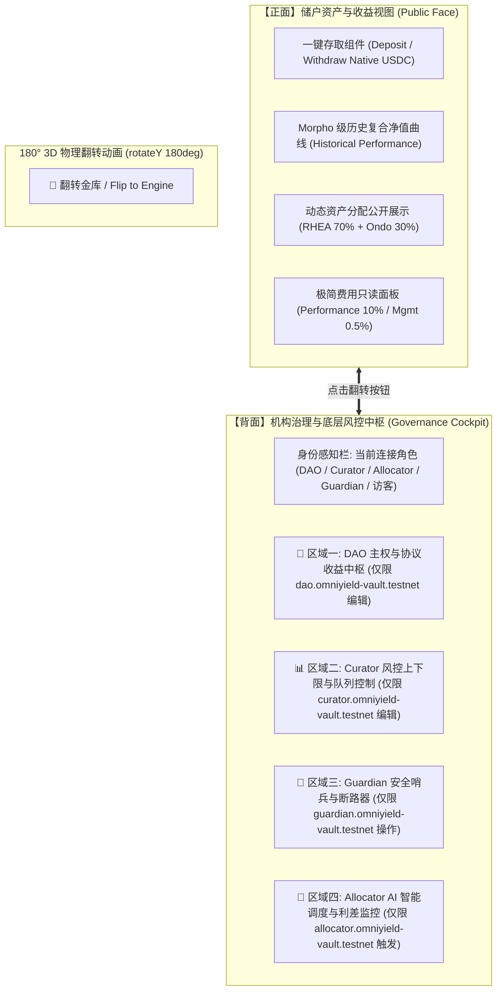

# OmniYield Protocol: “一体两面 (Dual-Faced Vault)” 交互架构与权限中枢方案

> **设计理念**：“一面是储户的极致纯粹，一面是机构的精密引擎”  
> **核心交互**：3D 180° 卡牌物理翻转（3D Flip Animation）  
> **权限模型**：动态角色识别（RBAC - Role-Based Access Control）+ 链上参数实时互锁

---

## 1. 方案背景与设计哲学

在当前的 DeFi 界面设计中，普遍存在两大痛点：
1. **信息过载（臃肿化）**：普通储户只关心“存入多少、收益多高、安全如何”，如果将繁杂的管理配置、多签参数、风控限额堆在首页，会极大抬高认知门槛，劝退普通用户。
2. **割裂的后台（碎片化）**：如果把管理设置单独做一个隐藏的 `/admin` 页面，又违背了 Web3 协议“公开透明、人皆可查（Verifiable by Anyone）”的密码朋克原则，且投资人无法直观感知金库背后的精密风控。

### “一体两面”的颠覆性解法：
将整个 OmniYield 金库设计为一张具有物理厚度与机械美感的**“3D 双面实体资产卡片”**：
- **正面（Public Face - 资本与收益）**：为普通投资者打造。纯粹、极简、无冗余按钮，呈现充提交互、历史净值曲线、资产配置比例与公开透明的 Morpho 费用只读面板。
- **180° 翻转交互（3D Card Flip）**：页面右上角或金库卡片顶部设立醒目的 **`🔄 3D 翻转至底层治理背面 (Flip to Vault Engine)`** 按钮。点击后，界面以物理 3D 视角（CSS `perspective: 1200px; transform: rotateY(180deg)`) 丝滑旋转 180 度。
- **背面（Governance Face - 机构治理与底层控制台）**：为金库四大角色打造。根据连接的不同钱包地址，**智能点亮对应权能的编辑栏位**，未授权栏位呈现精致的“半透明防篡改锁定状态”。

---

## 2. 正面与背面功能全景规划



---

## 3. 背面控制台：四大角色动态权限感知与交互矩阵

当用户翻转到金库背面时，系统根据当前连接的钱包，自动执行**权限点亮与互锁机制（Active vs Locked）**：

### 区域 1：DAO Multi-Sig 主权与收益控制台
- **权限归属**：仅限 `dao.omniyield-vault.testnet` 可编辑，其他账户显示只读锁（`🔒 Read-Only`）。
- **可操作栏位**：
  1. **业绩提成比例 (Performance Fee)**：输入框（0% ~ 50%），输入后实时换算 bps。
  2. **资产管理年化费率 (Management Fee)**：输入框（0% ~ 5%）。
  3. **收益接收地址 (Fee Recipients)**：业绩提成与管理费收款账户设定。
  4. **四权角色交接与轮换 (Role Rotation)**：移交 Curator、Allocator、Guardian 权限给新多签地址。
  5. **基础时间锁周期 (Timelock Duration)**：设定风险增加操作的缓冲时间（默认 24h）。
- **交互效果**：当以 DAO 钱包登录时，输入框亮起翡翠绿霓虹边框，右侧出现 **`[Broadcast on NEAR]`** 广播按钮。

### 区域 2：Curator 专业风控与市场编排台
- **权限归属**：仅限 `curator.omniyield-vault.testnet`（及 DAO）可编辑。
- **可操作栏位**：
  1. **子市场资金上限 (Supply Caps)**：
     - RHEA Lending Cap（当前 \$7,000,000）
     - Ondo RWA Cap（当前 \$100,000,000）
     - **智能提示**：调低（降风险）提示 `⚡ 0s 即时生效`；调高（增风险）提示 `⏳ 触发 24h 时间锁`。
  2. **双队列动态排序 (Dual Queue Order)**：
     - 充值优先队列（Supply Queue）：拖拽或切换排序（1. RHEA ➔ 2. Ondo）。
     - 提现优先队列（Withdraw Queue）：拖拽或切换排序（1. Ondo ➔ 2. RHEA）。
  3. **OmniSocket™ 收益插槽管理**：接入新市场或暂停指定插槽。
- **交互效果**：以 Curator 登录时，对应输入框亮起青色（Cyan）边框。

### 3. 区域 3：Guardian 独立安全哨兵与熔断中枢
- **权限归属**：仅限 `guardian.omniyield-vault.testnet` 可操作。
- **可操作栏位**：
  1. **24h 时间锁一键 VETO (作废提案)**：
     - 当 Curator 提出了扩容提案（如 \$7M ➔ \$10M），Guardian 栏位立即亮起红色警报，并出现巨大的 **`🚨 GUARDIAN VETO (Cancel Proposal)`** 按钮，点击直接作废时间锁提案！
  2. **紧急熔断断路器 (Circuit Breaker)**：
     - 遭遇预言机异常或底层协议漏洞时，一键切断目标市场注资，资金上限瞬间归零（Freeze）。
- **交互效果**：以 Guardian 登录时，栏位亮起亮粉红色（Rose）警报光效。

### 4. 区域 4：AI Allocator 调度状态与利差监控
- **权限归属**：仅限 `allocator.omniyield-vault.testnet` 可触发调度，任何人可查看 AI 决策依据。
- **展示与操作栏位**：
  1. **实时利差感知仪表盘**：RHEA (13.88%) vs Ondo (5.10%) 净息差利差监控（+8.78% Spread）。
  2. **一键强制重平衡 (Trigger Reallocate)**：在风控上限约束内，重新平衡各池配比。
  3. **收益计提触发器 (Trigger Accrue Yield)**：向金库注入利息并自动划拨提成。

### 5. 访客 / 普通储户在背面的绝佳体验：
- 当普通用户翻到背面时：
  - 不会报错，也不会被拒绝访问；
  - 能够清晰看到金库的所有底层配置参数，全透明可信；
  - 每个区域均带有清晰的徽章说明（如 `🔒 由 Curator 独立风控`、`🔒 由 DAO 多签治理`）；
  - **特别配备“角色切换模拟器（Role Switcher）”**：为黑客松评委与测试人员提供一键切换不同测试身份（DAO、Curator、Guardian）的便利按钮，无缝体验权限点亮效果！

---

## 4. 前端 3D 翻转交互技术实现架构

```css
/* 3D 翻转核心容器 */
.perspective-container {
  perspective: 1200px;
}

.flipper-card {
  transition: transform 0.7s cubic-bezier(0.4, 0, 0.2, 1);
  transform-style: preserve-3d;
}

.flipper-card.is-flipped {
  transform: rotateY(180deg);
}

.face-front, .face-back {
  backface-visibility: hidden;
  -webkit-backface-visibility: hidden;
}

.face-back {
  transform: rotateY(180deg);
}
```

- **触发展示点**：
  在页面顶栏或主卡片右上角放置一个兼具机械感与高科技感的翻转按钮：
  `[ 🔄 翻转金库：查看底层风控与治理背面 ]`
  悬停时带有 3D 浮动微动效，点击后整个主区域带缓动质感翻转 180 度，令人耳目一新。

---

## 5. 方案总结与核心优势

1. **极致的用户体验隔离**：普通用户在正面享受媲美苹果公司的极致简洁；
2. **世界级的机构透明度**：背面的存在让任何审计机构和机构 LP 随时翻转验算代码参数；
3. **黑客松绝佳亮点**：“一体两面”配合 3D 翻转动效与角色权限动态点亮，视觉冲击力与工程成熟度拉满，完全碾压传统平铺直叙的 Dashboard。

