# OmniYield Protocol: Institutional MetaMorpho 4-Role Governance Specification

> **Live Contract Account**: [`omniyield-vault.testnet`](https://testnet.nearblocks.io/address/omniyield-vault.testnet)  
> **Network**: NEAR Protocol Testnet  
> **Architecture Reference**: MetaMorpho Decoupled 4-Role Permission Matrix & ERC-4626 Vault Standard  
> **Security Audit Benchmark**: MetaMorpho (Spearbit / Cantina), Yearn v3, MakerDAO / Sky Governance

---

## 1. 架构哲学：为何彻底废弃传统的“单一管理员（Admin Owns Everything）”？

在早期的 DeFi 1.0 协议（如早期的 Fork 盘或普通 ERC-20 金库）中，常见的致命反模式是设置一个全能的 `admin` 或 `onlyOwner`：
- **致命痛点 1（Rug-Pull 风险）**：单一 Admin 拥有修改代币、提取储备金、修改手续费、升级合约的全部权力。一旦管理员私钥泄露或团队作恶，用户资金将瞬间归零。
- **致命痛点 2（风控与运营冲突）**：风控分析师需要即时调整借贷上限，高频套利/重平衡机器人需要毫秒级调度资金，多签治理理事会需要数天投票。如果所有操作都由一个账户执行，要么导致**资金调度极其迟缓**，要么导致**多签私钥频繁暴露在热钱包自动化脚本中**。
- **致命痛点 3（机构资金无法准入）**：顶级对冲基金、家族办公室和合规机构在尽调 DeFi 时，必须确保**“不存在任何单一实体能够在没有预警期（Timelock）的情况下挪用资金或突然改变风险特征”**。

为此，**OmniYield 协议完全复刻并强化了目前全球 DeFi 领域最高标准的 MetaMorpho 四权分立（Decoupled 4-Role Matrix）治理架构**，并在 NEAR 协议的命名账户（Named Account）原生体系下实现了清晰透明的链上权能隔离。

---

## 2. 国际一流 DeFi 治理体系全景对标

| 治理维度 | DeFi 1.0 传统金库 | MakerDAO / Sky | MetaMorpho (以太坊金库金标) | **OmniYield Protocol (NEAR 原生)** |
| :--- | :--- | :--- | :--- | :--- |
| **风控与资金调度分立** | ❌ 混在单一 Owner | ⚠️ 依赖治理投票与 GSM | ✅ **Curator 与 Allocator 彻底解耦** | ✅ **Curator 与 Allocator 彻底解耦** |
| **高频资金调度安全性** | ❌ 热钱包拥有全局特权 | ⚠️ Keeper 依赖预设撮合合约 | ✅ **Allocator 仅能在白名单市场内闭环调度** | ✅ **AI Allocator 仅限在白名单 Socket 间转移** |
| **恶性调整风险缓冲** | ❌ 无缓冲期，即时生效 | ✅ GSM 暂停执行器 (Pause Delay) | ✅ **24 小时强制安全时间锁 (Timelock)** | ✅ **24 小时强制安全时间锁 (Timelock)** |
| **紧急事故防御机制** | ❌ 仅 Owner 可暂停 | ✅ 紧急关闭模块 (Emergency Shutdown) | ✅ **独立 Guardian 一键否决与熔断** | ✅ **独立 Guardian 瞬时 VETO 否决与断路器** |
| **链上透明度与可读性** | ❌ 模糊的十六进制地址 | ❌ `0x...` 难以肉眼识别 | ❌ `0x...` 依赖标签库 | ✅ **NEAR 顶级命名账户 (`dao.`, `curator.`, etc.)** |

---

## 3. 四大核心角色权能全景矩阵 (The 4-Role Matrix)

```mermaid
flowchart TD
    subgraph Governance ["1. 战略与主权层 (Sovereignty & Treasury)"]
        OWNER["🏛️ Multi-Sig DAO Owner<br/><code>dao.omniyield-vault.testnet</code>"]
    end

    subgraph RiskManagement ["2. 专业风控层 (Risk Advisory & Underwriting)"]
        CURATOR["📊 Risk Curator (Steakhouse / Gosun)<br/><code>curator.omniyield-vault.testnet</code>"]
    end

    subgraph Automation ["3. 自动化调度层 (Algorithmic Execution)"]
        ALLOCATOR["🤖 AI Public Allocator (Autonomous Keeper)<br/><code>allocator.omniyield-vault.testnet</code>"]
    end

    subgraph Security ["4. 安全守卫层 (Independent Watchtower)"]
        GUARDIAN["🚨 Guardian Security Council<br/><code>guardian.omniyield-vault.testnet</code>"]
    end

    subgraph CoreVault ["OmniYield Meta-Vault 智能合约 (omniyield-vault.testnet)"]
        FUNDS["💰 用户资产金库 (Native USDC / NUSD)"]
        TIMELOCK["⏳ 24h 风险增加时间锁"]
        SOCKETS["🔌 OmniSocket™ 收益插槽 (RHEA / Ondo RWA)"]
    end

    OWNER -->|"设定角色/费率/时间锁时长"| CoreVault
    CURATOR -->|"提出上限扩容 (进入时间锁)"| TIMELOCK
    CURATOR -->|"下调上限 / 调整充提优先级队列"| SOCKETS
    GUARDIAN -->|"24h 窗口内一键 VETO (作废提案)"| TIMELOCK
    GUARDIAN -->|"紧急熔断市场 (Freeze)"| SOCKETS
    ALLOCATOR -->|"仅在上限内执行利差搬砖 reallocate()"| SOCKETS

    classDef ownerStyle fill:#0f172a,stroke:#3b82f6,stroke-width:2px;
    classDef curatorStyle fill:#0f172a,stroke:#10b981,stroke-width:2px;
    classDef allocatorStyle fill:#0f172a,stroke:#06b6d4,stroke-width:2px;
    classDef guardianStyle fill:#0f172a,stroke:#f43f5e,stroke-width:2px;
    class OWNER ownerStyle;
    class CURATOR curatorStyle;
    class ALLOCATOR allocatorStyle;
    class GUARDIAN guardianStyle;
```

---

### 角色 1：Owner (Multi-Sig DAO 金库所有者)
- **链上实体账户**：[`dao.omniyield-vault.testnet`](https://testnet.nearblocks.io/address/dao.omniyield-vault.testnet)
- **对标体系**：Sputnik DAO / Safe 多签理事会 / MetaMorpho Vault Owner
- **职责定位**：金库的最高主权与治理中枢。采用多重签名（Multi-Sig）管理，动作迟缓但具备最高防御等级。
- **可执行方法与权限**：
  1. `set_owner(new_owner_id)`：交接转移金库所有权至新 DAO 或升级合约。
  2. `set_curator(new_curator_id)`：任命或撤换专业风控评估机构（Curator）。
  3. `set_allocator(new_allocator_id)`：任命或撤换链下 AI 自动化资金调度器（Allocator）。
  4. `set_guardian(new_guardian_id)`：任命或更换独立安全监事会（Guardian）。
  5. `set_timelock_duration(duration_ns)`：调整风险时间锁时长（默认 24 小时，硬编码下限）。
  6. `set_performance_fee(fee_bps)`：配置业绩提成比例（上限 50.0%）。
  7. `set_management_fee(fee_bps)`：配置资产管理规模年化费率（上限 5.0%）。
  8. `set_performance_fee_recipient(recipient)` / `set_management_fee_recipient(recipient)`：指定协议收益收款地址。
  9. `set_base_asset_id(asset_id)`：指定底层存取储备资产（Circle 原生 USDC）。
- **权力边界与安全约束**：
  - **绝不能跳过时间锁直接扩大风险敞口**；
  - **绝不能任意提取储户存入金库的本金**；
  - 角色变更与费率调整必须通过多签签名，严防单点失陷。

---

### 角色 2：Curator (风控评级与市场策划机构)
- **链上实体账户**：[`curator.omniyield-vault.testnet`](https://testnet.nearblocks.io/address/curator.omniyield-vault.testnet)
- **对标体系**：Steakhouse Financial、Gauntlet Network、Re7 Capital
- **职责定位**：专门从事信贷质量评估、流动性风险量化、底层抵押品审核的风控机构。
- **可执行方法与权限**：
  1. `submit_supply_cap_change(market_id, new_cap)`：提出**扩大**某个子市场的资金配额上限（**必须强制进入 24 小时时间锁队列**）。
  2. `set_supply_cap(market_id, new_cap)`：**即时调低**某个子市场的资金配额上限。当 Curator 发现底层协议出现坏账或安全苗头时，无需等待时间锁，**0 秒即时生效**，防止新资金流入风险池。
  3. `set_supply_queue(queue)`：配置金库资金优先存入的市场顺序（例如：优先存入高 APY 的 RHEA，满仓后再存入 Ondo RWA 美债）。
  4. `set_withdraw_queue(queue)`：配置储户赎回资金时的抽水顺序（例如：优先从高流动性零滑点的 Ondo RWA 抽水，避免冲击借贷市场造成借款人被动平仓）。
  5. `register_yield_socket(...)`：审核并接入全新的第三方收益子插槽（如 Burrow、LiNEAR、Trisolaris 等）。
  6. `set_socket_status(socket_id, is_active)`：启用或下架特定收益插槽。
- **权力边界与安全约束**：
  - **绝不能直接触碰任何资金**（Curator 没有划转资金给任何外部钱包的权限）；
  - **不能任意提取收益**；
  - 任何放大系统风险的操作（如提高上限）必须接受 24 小时倒计时制约。

---

### 角色 3：Allocator (AI 自动化资产调度器 / Keeper)
- **链上实体账户**：[`allocator.omniyield-vault.testnet`](https://testnet.nearblocks.io/address/allocator.omniyield-vault.testnet)
- **对标体系**：Morpho Public Allocator、Yearn Keep3r Network、Gelato Automate
- **职责定位**：7x24 小时不间断运行的链下高频 AI 交易代理。监控多链收益率价差，执行自动跨市场再平衡（Rebalancing）。
- **可执行方法与权限**：
  1. `reallocate(allocations)`：在白名单子市场之间动态划拨资本头寸。
     - 例如：将 100 万 USDC 从 5.1% 的 Ondo 美债池调往 13.88% 的 RHEA 借贷池，实现金库整体复合 APY 最大化。
  2. `accrue_yield(market_id, yield_amount)`：触发复利结算，扣除业绩提成并铸造份额给 DAO 国库。
- **权力边界与数学硬约束（Mathematical Invariants）**：
  - **闭环约束**：`reallocate` 只能在已注册的白名单市场中分配，**输入的目标参数必须严格等于金库总资产，绝不可能把哪怕 1 聪钱转出金库体系**；
  - **上限绝不可穿透**：任何市场的划拨金额如果超过了 Curator 设定的 `supply_cap`，智能合约底层直接 `panic!("Supply cap exceeded")` 交易回滚；
  - 即使 Allocator 私钥完全暴露给黑客，黑客也无法盗走资金，最多只能在已通过风控审计的白名单安全池子之间调整配比。

---

### 角色 4：Guardian (安全监事会与应急断路器)
- **链上实体账户**：[`guardian.omniyield-vault.testnet`](https://testnet.nearblocks.io/address/guardian.omniyield-vault.testnet)
- **对标体系**：SEAL 911 应急响应网络、MakerDAO Emergency Shutdown Council、Compound Pause Guardian
- **职责定位**：由专业安全审计机构、白帽子安全基金会组成的独立风控哨兵，专门行使**防守性否决权**。
- **可执行方法与权限**：
  1. `cancel_supply_cap_change(market_id)`：**瞬时 VETO 否决权**。在 24 小时时间锁期间，如果 Guardian 判定 Curator 的扩容提议存在串通攻击或底层协议漏洞，可直接单方面作废该提案。
  2. `emergency_pause_market(market_id)`：**紧急熔断断路器**。当底层市场发生闪电贷攻击、预言机脱锚或安全漏洞时，Guardian 可一键冻结该市场的存取与调度，将资金上限归零。
  3. `emergency_resume_market(market_id, restored_cap)`：排查解除风险后，恢复该市场运转。
- **权力边界与安全约束**：
  - **纯防御性单向权力（Negative Power Only）**：Guardian 只能**停止（Halt）、暂停（Pause）或取消（Veto）**，**完全不具备转移资产或提取费用的能力**；
  - 这种设计即使 Guardian 被黑，也绝不会造成任何资金损失，只会触发系统防御性停机。

---

## 4. 24 小时强制安全时间锁机制 (The 24h Timelock Invariant)

时间锁是机构级 DeFi 协议区分于普通小项目的试金石。

### 核心运作流程：
1. **风险递增操作触发时间锁**：
   - 假定 Curator 拟将高风险子市场（RHEA Lending）的资金配额从 \$7,000,000 扩大至 \$10,000,000；
   - 调用 `submit_supply_cap_change("rhea-lending", 10_000_000)`；
   - 链上生成带时间戳的提案记录，设定可执行时间 `executable_at_ns = block_timestamp + 86,400s`。
2. **24 小时公众观察与无损退出窗口（24-Hour Exit Window）**：
   - 在这 24 小时内，该上限调整**不生效**；
   - 储户若不信任该扩容决策，拥有**整整 24 小时充足时间无条件 100% 赎回本息离场**；
   - Guardian 正在密切监控链上日志，若发现异常可一键调用 `cancel_supply_cap_change` 予以作废。
3. **到期执行**：
   - 24 小时后，Curator 调用 `execute_supply_cap_change("rhea-lending")`，新上限才正式生效。

### 不对称风控设计（Asymmetric Design）：
- **风险放大（扩容/降低要求）**：强制 24 小时延迟；
- **风险收缩（降额/紧急熔断）**：0 秒即刻生效。

---

## 5. 链上角色分配与治理实体验证

得益于 NEAR 协议独有的**顶级账户与子账户层次化命名系统（Hierarchical Account IDs）**，OmniYield 的所有角色均采用人眼可辨读的专业命名，杜绝了以太坊上十六进制地址容易混淆伪造的弊端：

| 角色类型 | NEAR 链上真实账户 | 身份归属与多签结构 | 链上部署/配置验证交易 (Tx Hash) |
| :--- | :--- | :--- | :--- |
| **金库主合约** | `omniyield-vault.testnet` | OmniYield NEP-141 智能合约 | [`ARjwwhMBtQx...`](https://testnet.nearblocks.io/txns/ARjwwhMBtQxVfQ3FTW6CJXY3qwM3atStStAUrzWkeiWD) |
| **Owner (DAO)** | `dao.omniyield-vault.testnet` | Sputnik DAO 多签理事会 (Multi-Sig) | [`4f7rcfw8WrL...`](https://testnet.nearblocks.io/txns/4f7rcfw8WrLqCpAuvNWP6XzfUbiaTHQxQPSsx5JvcZb5) |
| **Curator** | `curator.omniyield-vault.testnet` | 专业信贷风控机构 (Steakhouse / Gosun) | [`HyYxYZNZhVh...`](https://testnet.nearblocks.io/txns/HyYxYZNZhVhAqazc3iJncRq7txJK6RFi6ZYPpMAg4reL) |
| **Allocator** | `allocator.omniyield-vault.testnet` | 链下自主 AI Keeper 代理服务 | [`9t5nTdp38Dm...`](https://testnet.nearblocks.io/txns/9t5nTdp38DmwkfMtTgxQXdLH27NvkCkChp8zHDUwFveZ) |
| **Guardian** | `guardian.omniyield-vault.testnet` | 独立安全审计委员会 (Security Council) | [`CdK68QqerKp...`](https://testnet.nearblocks.io/txns/CdK68QqerKpLACzfN5CLKRCx1oHXQU2e4ct3BWrvynvT) |

---

## 6. 总结：机构级金库的终极防线

OmniYield 协议通过在智能合约底层确立四权分立：
1. **没有任何私钥能独断专行**；
2. **没有任何黑客入侵自动化服务能卷走本金**；
3. **没有任何风控上调能避开 24 小时公众监督**；
4. **没有任何协议异常能逃过 Guardian 的瞬间熔断**。

这套体系代表了当今 Web3 与智能资产管理协议的**最高工业水准**，为承载千万级乃至亿美元级流动性筑牢了最坚不可摧的安全基石。

