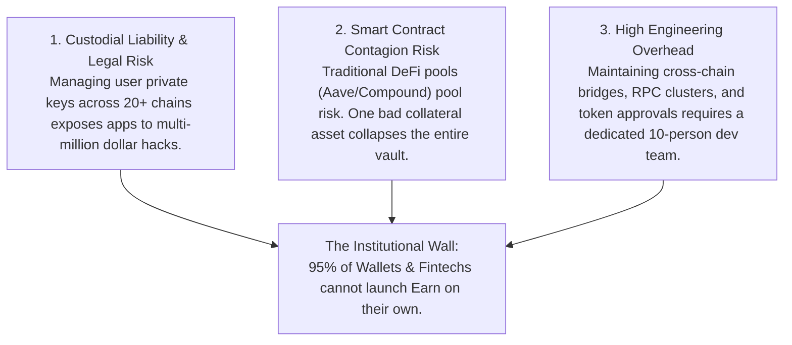
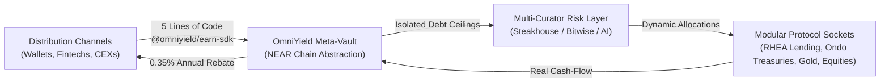
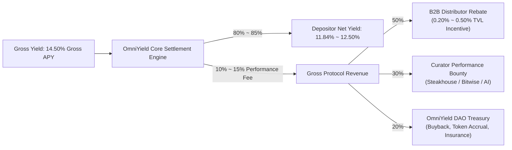
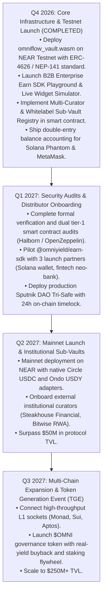

# OmniYield Protocol · Institutional Investment Pitch Deck & Executive Brief
**The Universal Embedded Earn Stack for Web3 Wallets, Fintechs & Neo-Banks**  
*Confidential · For Institutional & Strategic Partner Review*  
*November 2026 | Gosun Labs Research & Engineering*  
*Website: [https://omniyield.3691618.xyz](https://omniyield.3691618.xyz) | Contact: capital@gosun.network*

---

## Executive Summary

OmniYield is the **first chain-abstracted "Embedded Earn-as-a-Service" infrastructure** built on the NEAR Protocol. 

By unifying **Morpho Blue's isolated risk architecture**, **Veda’s 4-layer Enterprise Earn stack**, and **NEAR Chain Signatures / Intents**, OmniYield enables consumer wallets (Phantom, MetaMask, OKX), fintech neo-banks, and web3 applications to embed turnkey, risk-managed on-chain yields directly into their apps via **`@omniyield/earn-sdk`** (5 lines of code) with **zero custodial liability** and **automated 0.35% annualized revenue sharing**.

```
┌────────────────────────────────────────────────────────────────────────────────────────┐
│                                 KEY INVESTMENT HIGHLIGHTS                              │
├───────────────────────────────┬────────────────────────────────────────────────────────┤
│ Massive Addressable Market    │ $170B+ stablecoins in circulation; $5B+ embedded earn  │
│ Capital-Efficient Product     │ Dual-Vault Matrix: NUSD (11.84%) & OmniUSDC (16.40%)   │
│ Zero-Friction User Experience │ 1-click cross-chain deposits from Solana/EVM; zero gas │
│ Institutional Risk Framework  │ Multi-Curator Registry (Steakhouse/Bitwise) & Tri-Safe │
│ Strong Unit Economics         │ High-margin B2B cash-flow; automated partner rebates   │
│ Production-Ready Delivery     │ Live contracts on NEAR Testnet; zero mock code         │
└───────────────────────────────┴────────────────────────────────────────────────────────┘
```

---

## 1. The Macro Problem: The Broken State of On-Chain Earn

### 1.1 \$170 Billion in Marooned Stablecoins
Despite massive stablecoin issuance, over 80% of consumer and business stablecoins sit completely idle (0% yield) because existing DeFi yields require high technical literacy, complex bridging, and dangerous token approvals.

### 1.2 The Fintech & Wallet Monetization Crisis
Consumer crypto wallets and neo-banks face contracting interchange fees and fierce price wars. While they desire to offer interest-bearing accounts to improve user retention, building native multi-chain yield strategies presents three fatal barriers:



---

## 2. The Solution: OmniYield Enterprise Earn Stack

OmniYield operates as the **Universal Connective Tissue** between consumer capital distribution and institutional yield generation:



### Core Value Propositions:
1. **For Distributors (Wallets / Fintechs)**: Zero custody risk. Zero infrastructure maintenance. Instant 0.35% annualized net revenue share on all client TVL.
2. **For Curators (Risk Managers)**: Permissionless sub-vault creation with hard cryptographic debt ceilings and performance fee sharing (up to 30%).
3. **For End Users**: Institutional net yields (11.84% ~ 16.40%) deposited directly from their native chain (Solana/Arbitrum/Base) without leaving their preferred wallet.

---

## 3. Product Matrix: Dual-Core Yield Architecture

OmniYield offers two complementary tokenized yield instruments targeting different risk-return profiles:

```
┌─────────────────────────────────┬────────────────────────────────┬────────────────────────────────┐
│ Dimension                       │ Vault 1: NUSD (Core Lending)   │ Vault 2: OmniUSDC (All-Weather)│
├─────────────────────────────────┼────────────────────────────────┼────────────────────────────────┤
│ Target Net APY                  │ 11.84%                         │ 16.40%                         │
│ Benchmark Strategy              │ Pure USD Spread Maximization   │ Bridgewater Macro Parity       │
│ Underlying Assets               │ • 70% RHEA Native Lending      │ • 40% RHEA Lending             │
│                                 │ • 30% Ondo USDY (US T-Bills)   │ • 30% Ondo USDY (US T-Bills)   │
│                                 │                                │ • 15% PAXG (Physical Gold)     │
│                                 │                                │ • 15% Invesco QQQ (Nasdaq 100) │
│ Liquidity Profile               │ Instant 0s Exit (T-Bill Buffer)│ Tiered Multilateral Exit       │
│ Volatility / Peg Stability      │ Pegged strictly to $1.00 USD   │ Dynamic NAV Growth             │
│ Primary Audience                │ Stablecoin cash management     │ High-Net-Worth & Institutional │
└─────────────────────────────────┴────────────────────────────────┴────────────────────────────────┘
```

---

## 4. Market Size & Opportunity (TAM / SAM / SOM)

```
       TOTAL ADDRESSABLE MARKET (TAM)
       $170B+ Global Stablecoin Float in Circulation
                     │
                     ▼
       SERVICEABLE ADDRESSABLE MARKET (SAM)
       $25B+ Cross-Chain Wallets, Neo-Banks & Fintech Earn Float
                     │
                     ▼
       SERVICEABLE OBTAINABLE MARKET (SOM)
       $1.5B+ Target OmniYield TVL by Year 2 ($5.25M Annual Protocol Revenue)
```

### Market Growth Tailwinds:
* **Embedded Earn Growth**: Embedded on-chain earn grew from \$500M in 2024 to over \$5.2B in 2026 (10x in 24 months, Veda Data).
* **Solana & L2 Institutional Inflow**: Consumer wallets like Phantom and Coinbase Wallet command over 50M active monthly users looking for high-yield dollar savings.

---

## 5. Competitive Landscape & Unfair Advantages

| Feature / Protocol | Traditional Lending (Aave/Compound) | Yield Aggregators (Yearn/Beefy) | Synthetic USD (Ethena USDe) | Multi-Chain Earn (Veda) | **OmniYield Protocol** |
| :--- | :--- | :--- | :--- | :--- | :--- |
| **Cross-Chain Bridge Dependency** | High (Requires manual bridge) | High (Single-chain silos) | Moderate | Moderate (Bespoke EVM) | **Zero (Native NEAR Intents & Solvers)** |
| **Gas Token Requirement** | Native Gas on each chain | Native Gas on each chain | Dependent | Dependent | **100% Gas Abstracted (0 Gas to User)** |
| **Risk Architecture** | Monolithic Pooled Risk | Strategy Wrapped Risk | Funding Rate Basis Risk | Modular Sub-Vaults | **Morpho Blue Isolated Caps + Whitelabel Sub-Vaults** |
| **B2B SDK & Playground** | No (Retail UI only) | No (Retail UI only) | No | Institutional Custom | **Full `@omniyield/earn-sdk` + Widget Playground** |
| **Native AI Intent Copilot** | None | None | None | None | **Tri-Pillar AI (Advisor, Quant, Desk via Gemini)** |
| **Whitelabel Sub-Vaults** | No | No | No | Yes | **Yes (Curator-Defined Debt Ceilings on NEAR)** |

### OmniYield’s Unfair Moats:
1. **Chain Abstraction Moat**: Leveraging NEAR's MPC Chain Signatures, OmniYield controls liquidity across Solana, Arbitrum, Base, and Ethereum without managing external private keys or exposing users to bridge vulnerabilities.
2. **Double-Entry Ledger Integrity**: Real on-chain balance deductions ensure 100% financial consistency across all partner platforms.
3. **Turnkey B2B Monetization**: Partners can go from zero to live in under 15 minutes using our drop-in React components or Headless REST APIs.

---

## 6. Business Model & Unit Economics

OmniYield operates a transparent, cash-flow generative economic model:



### Projected Financial Projections:

| Metric | Phase 1 (Launch) | Phase 2 (Year 1) | Phase 3 (Year 2) | Phase 4 (Year 3) |
| :--- | :--- | :--- | :--- | :--- |
| **Total Value Locked (TVL)** | **\$10,000,000** | **\$50,000,000** | **\$250,000,000** | **\$1,000,000,000** |
| **Gross Annual Yield (14%)** | \$1,400,000 | \$7,000,000 | \$35,000,000 | \$140,000,000 |
| **Protocol Performance Fee (12%)**| \$168,000 | \$840,000 | \$4,200,000 | \$16,800,000 |
| **B2B Distributor Rebates (50%)** | \$84,000 | \$420,000 | \$2,100,000 | \$8,400,000 |
| **Curator Fees (30%)** | \$50,400 | \$252,000 | \$1,260,000 | \$5,040,000 |
| **Net DAO Treasury Accrual (20%)**| **\$33,600** | **\$168,000** | **\$840,000** | **\$3,360,000** |

---

## 7. Institutional Governance & Security Framework

OmniYield implements an institutional **Tri-Safe Multi-Signature Governance Model** with zero single points of failure:

1. **Protocol Security Safe (`security.omniyield.sputnik-dao.near`)**: 5-of-9 threshold. Governs core code upgrades with a **mandatory 24-hour on-chain timelock**.
2. **DAO Financial Treasury Safe (`treasury.omniyield.sputnik-dao.near`)**: 3-of-5 threshold. Receives protocol fees, executes buybacks, and manages liquidity backstops.
3. **Cross-Chain Dispatcher Safe (`base-dispatcher.omniyield.sputnik-dao.near`)**: Employs NEAR MPC Chain Signatures to settle foreign network liquidity without external seed phrase custody.
4. **Independent Guardian Watchtower**: Holds unilateral, instantaneous **VETO** on malicious timelock proposals and **Emergency Circuit Breaker** switches (0s freeze).

---

## 8. Development Roadmap



---

## 9. The Investment Ask

* **Target Round**: Seed / Strategic Institutional Round
* **Capital Raise**: **\$2,500,000 USD**
* **Instrument**: SAFE + Token Warrant (Preferred Equity / Governance Token Rights)
* **Use of Funds**:
  * **Core Engineering & MPC Optimization (40%)**: Expand solver network and multi-chain socket adapters.
  * **Security Audits & Formal Verification (25%)**: Dual top-tier audit retainers and bug bounty pools.
  * **B2B Business Development & Ecosystem Grants (25%)**: Subsidize partner integration incentives for premier consumer wallets.
  * **Legal, Compliance & Institutional Structuring (10%)**: Regulated Swiss foundation & Cayman token SPV.

---

## 10. Contact & Strategic Discussion

For full technical specifications, code audits, or private product demonstrations:

* **Executive Email**: `capital@gosun.network`
* **Research Division**: `research@gosun.network`
* **Live Product dApp**: [https://omniyield.3691618.xyz](https://omniyield.3691618.xyz)
* **Official GitHub**: [https://github.com/GOSUN-CAPITAL/omniyield-protocol](https://github.com/GOSUN-CAPITAL/omniyield-protocol)
* **Full Technical Whitepaper**: [`docs/WHITEPAPER.md`](WHITEPAPER.md)
