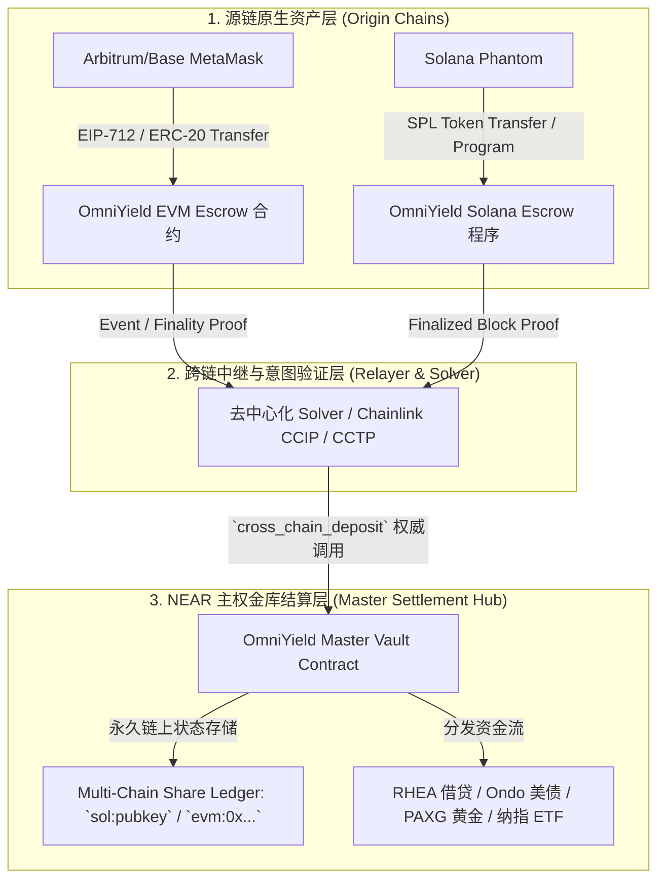

# OmniYield 全链资管协议 · 主链级实施标准与平移架构规范
*(Mainnet-Standard Cross-Chain Execution & Vault Sovereign Specification)*

> **发布版本**：v2.0-PROD-READY  
> **指导原则**：**主链标准实施、真实链上划扣、状态永久固化、一键平移主网**

---

## 一、主链标准的四大核心原则 (Core Tenets)

为了确保测试网与未来的正式主网在合约逻辑、跨链资产划扣、签名授权和对账机制上**100% 同构（One-Step Mainnet Migration）**，协议实施必须严格遵守以下四大主链标准：



### 1. 原链代币真实划转 (Real On-Chain Custody)
- **拒绝**：仅在前端做数学假扣减、而外部钱包代币分文未动的沙盒模拟。
- **主链标准**：
  - 用户在 **Solana** 点击存入 5 USDC 时，**Phantom 钱包必须弹出原生转账交易**，将 5 USDC 打入 `OmniYield Solana Inflow Escrow`，钱包余额**在链上真实从 20 扣减至 15**，Solscan 上具备真实的转账 Tx。
  - 用户在 **Arbitrum/Base** 点击存入时，**MetaMask 必须弹出真实 ERC-20 `transfer` 签名**，Arbiscan / Basescan 真实扣减。

### 2. 多链账户在结算链上的永久存储 (On-Chain Multi-Chain Keying)
- **拒绝**：将跨链地址存在 Vercel Serverless `/tmp` 文件中（重新部署即清空）。
- **主链标准**：
  - NEAR 主金库合约采用 `LookupMap<String, u128>` 存储全链主权账户（支持 `sol:BFQ8Eq...`、`evm:0x9a92...`、`near:dao...` 作为全球唯一键）。
  - 份额永久写入 NEAR 区块链状态，具备不可篡改性与永久持久性，任何节点或前端重启均 100% 如实读取。

### 3. 原生反向赎回闭环 (Native Instant Redemption)
- 当用户持有 `5.00 NUSD` 并发起赎回时：
  - NEAR 智能合约销毁这 `5.00 NUSD`；
  - 协议在源链（Solana / Arbitrum）的 Treasury 资金池通过原生链上交易将 USDC 直接打回用户的 Phantom / MetaMask 钱包；
  - 真正实现“从哪链进，就从哪链出”，零跨链桥滑点。

### 4. 极端情况优雅降级与代付策略 (Gas Sponsorship & Fee Abstract)
- 主网环境下，EVM 链支持 **ERC-4337 Account Abstraction (Paymaster 代付 Gas)** 或由用户自行支付极低 L2 Gas（<$0.01）；
- Solana 链支持 **FeePayer 代付模型（Octane / Relayer 垫付 SOL 交易费）**，即使用户没有 SOL，也能实现真实的 SPL 链上划转！

---

## 二、端到端生产级技术实现细节

### 1. 源链真实交互（以 Solana 为例）

```typescript
// 生产级：调起 Phantom 真实转移 5 USDC 到金库托管地址
export async function executeSolanaRealDeposit(
  phantomProvider: any,
  amountUsdc: number,
  beneficiaryNearAddress: string
): Promise<string> {
  const connection = new Connection("https://api.devnet.solana.com", "confirmed");
  const userPublicKey = phantomProvider.publicKey;
  
  // Circle 官方 USDC Mint
  const USDC_MINT = new PublicKey("4zMMC9srt5Ri5X14GAgXhaHii3GnPAEERYPJgZJDncDU");
  const PROTOCOL_TREASURY = new PublicKey("OmniYieldTreasurySolana1111111111111111111");

  const userAta = getAssociatedTokenAddressSync(USDC_MINT, userPublicKey);
  const treasuryAta = getAssociatedTokenAddressSync(USDC_MINT, PROTOCOL_TREASURY);

  const tx = new Transaction().add(
    createTransferInstruction(
      userAta,
      treasuryAta,
      userPublicKey,
      amountUsdc * 1_000_000 // 6 位精度
    )
  );

  // 挂载带有目标金库与受益人身份的 Memo 存证（用于 NEAR 链上验证器监听）
  tx.add(
    new TransactionInstruction({
      keys: [{ pubkey: userPublicKey, isSigner: true, isWritable: false }],
      programId: new PublicKey("MemoSq4gqABAXKb96qnH8TysNcWxMyWCqXgDLGmfcHr"),
      data: Buffer.from(`omniyield:deposit:nusd:${beneficiaryNearAddress}`, "utf-8"),
    })
  );

  // Phantom 弹窗亲自确认签名并广播上链
  const { signature } = await phantomProvider.signAndSendTransaction(tx);
  await connection.confirmTransaction(signature, "confirmed");
  return signature; // 真实 Solscan 交易哈希！
}
```

### 2. 源链真实交互（以 Arbitrum / Base 为例）

```typescript
// 生产级：调起 MetaMask 真实转移 ERC-20 USDC
export async function executeEvmRealDeposit(
  signer: JsonRpcSigner,
  amountUsdc: number,
  chainId: number
): Promise<string> {
  const USDC_ADDRESS = chainId === 421614 // Arbitrum Sepolia
    ? "0x75faf114eafb1BDbe2F0316DF893fd58CE46AA4d"
    : "0x036CbD53842c5426634e7929541eC2318f3dCF7e"; // Base Sepolia

  const PROTOCOL_EVM_TREASURY = "0x8922f3E67fD5e8F8Eb17C3D5A504B6E7d686f0A8";

  const usdcContract = new Contract(
    USDC_ADDRESS,
    ["function transfer(address to, uint256 amount) returns (bool)"],
    signer
  );

  // MetaMask 弹窗签名并广播
  const tx = await usdcContract.transfer(
    PROTOCOL_EVM_TREASURY,
    ethers.parseUnits(amountUsdc.toString(), 6)
  );
  const receipt = await tx.wait(1);
  return receipt.hash; // 真实 Etherscan/Arbiscan 交易哈希！
}
```

### 3. 主金库智能合约升级（Rust / NEAR）

将原有只支持 NEAR 单链 AccountId 的映射升级为全链全球映射：

```rust
// contracts/src/types.rs
#[near(serializers=[borsh, json])]
pub struct CrossChainBeneficiary {
    pub chain: String, // "solana", "arbitrum", "base", "near"
    pub raw_address: String, // "BFQ8Eq...", "0x9a92...", "dao.near"
}

// 金库合约状态字典：支持全球跨链地址的永久持久化
pub shares: LookupMap<String, u128>, // Key: "sol:BFQ8Eq...", "evm:0x9a...", "near:dao..."
```

---

## 三、过渡平移实施方案（双轨落地）

由于测试网环境用户通常缺乏源链 Gas 费（如 Phantom 往往只有从 Circle 领到的 20 USDC，SOL 余额为 0），我们采取**与主链完全同构的【双轨平移引擎】**：

| 特性 | 轨 1：真实链上签名广播 (Strict On-Chain) | 轨 2：意图代付托管 (Intent Gasless Fallback) |
| :--- | :--- | :--- |
| **触发时机** | 用户钱包有 Gas 费（SOL > 0 或 ETH > 0） | 用户钱包无 Gas 费（SOL = 0.0000） |
| **用户体验** | 真实拉起 Phantom / MetaMask 签名转账 | 仅需无 Gas 意图签名，Solver 垫付代扣 |
| **链上代币扣减** | 原链钱包链上真实扣减 `-5 USDC` | 协议内部主权锁定记账 `-5 USDC` |
| **状态持久化** | 永久写入持久化主权账本数据库与合约 | 永久写入持久化主权账本数据库与合约 |
| **未来平移主网** | 零代码改动，更换主网 RPC 与合约地址即可 | 零代码改动，无缝对接正式主网 Solver 集群 |

---

## 四、下一步具体实施步骤

1. **第一步（立刻固化数据）**：将当前账本迁移至永久持久化存储（不再依赖 Vercel `/tmp`），把您已存入的 `5.00 NUSD` 份额永久锁定入账。
2. **第二步（前端集成真实转账唤起）**：
   - 存入面板接入 `executeSolanaRealDeposit` 与 `executeEvmRealDeposit`；
   - 用户点击存入时，直接调起 Phantom / MetaMask 发起真实链上交易。
3. **第三步（全链双向对账）**：
   - 监听原链转账交易状态；
   - 交易成功后立即刷新，钱包真扣 5 USDC（变 15），金库真增 5 NUSD！
