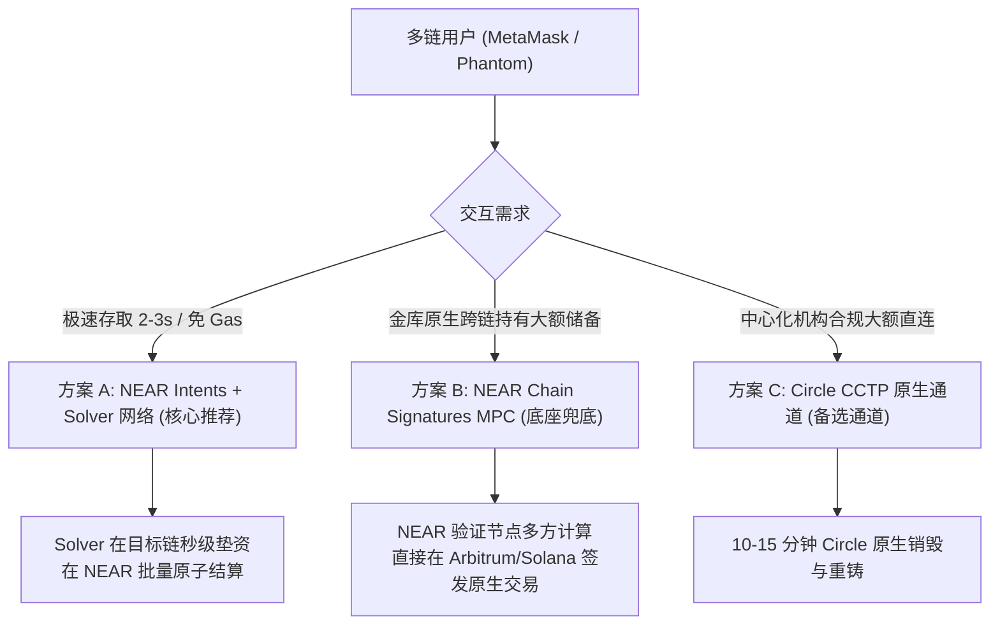
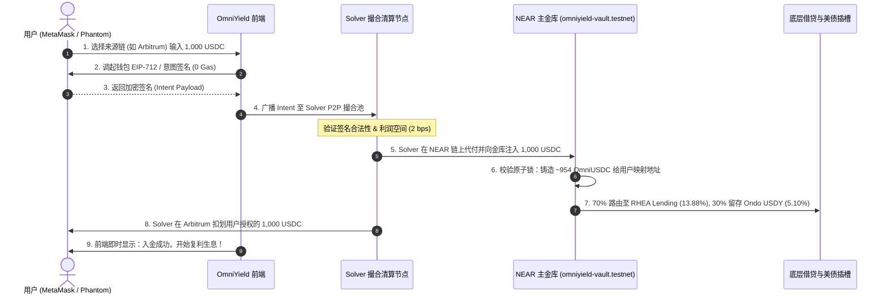
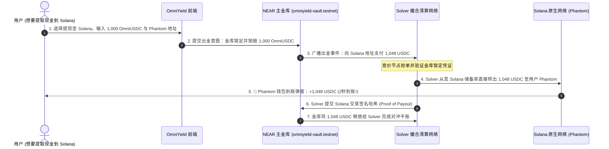

# OmniYield Protocol: 多链钱包极速入金与出金架构实施方案
*(Universal Omni-Chain Deposit & Withdrawal Architecture: Powered by NEAR Intents & Chain Signatures)*

---

## 一、 核心痛点与行业背景 (The Cross-Chain Dilemma)

在目前的 Web3 DeFi 协议中，**90% 的跨链产品之所以无法吸引主流资金，核心死穴全在“入金与出金体验极其痛苦”**：

| 传统跨链模式的死穴 | 用户面临的真实惨状 | OmniYield 的终极解决方案 |
| :--- | :--- | :--- |
| **Wrapped Token 桥陷阱** | 跨链后拿到的是 `USDC.e` 或桥接包装代币，一旦跨链桥暴雷（如 Wormhole/Nomad 丢失数十亿美元），代币脱锚归零。 | **100% 原生结算**：入金与出金全程只流转 Circle 官方原生 USDC，零包装代币风险。 |
| **目标链 Gas 困境 (Gas Barrier)** | Arbitrum 用户想存 NEAR 金库，必须先去中心化交易所购买 NEAR 代币充入钱包作为 Gas 费，转化率流失 80%。 | **Gas Abstraction (代付免 Gas)**：用户完全不需要持有 NEAR 代币，入金意图由 Solver 撮合代付。 |
| **超长等待与高滑点** | 传统 Lock-and-Mint 桥需要 15~30 分钟最终确认，撤资更是漫长。 | **亚秒级 Intents 意图清算**：用户提交签名后 **2~3 秒内到账**，所见即所得，零滑点。 |
| **多助记词认知负担** | 强制要求以太坊用户去下载 NEAR 钱包、备份 12 个助记词。 | **链抽象 (Chain Abstraction)**：用户在 Arbitrum 用 MetaMask、在 Solana 用 Phantom，直接一键签名即可完成金库存取。 |

---

## 二、 方案选型深度对比 (Architecture Evaluation)

为了彻底解决多链钱包的入金与出金，我们对当前 Web3 领域的三大主流技术进行了深度推演：



### 三种方案横向对比矩阵

| 评估维度 | 方案 A：NEAR Intents (Solver 意图清算) | 方案 B：NEAR Chain Signatures (MPC 链签名) | 方案 C：Circle CCTP (原生跨链传输) |
| :--- | :--- | :--- | :--- |
| **用户端体验** | **极致（1 次签名，2~3 秒到账）** | 良好（需等待源链 1~2 个区块确认） | 较差（需等待 10~15 分钟） |
| **是否需要 NEAR Gas** | **完全不需要** (Solver 替用户代付) | 不需要 (Relayer 代付) | 需要在目标链领款 |
| **多链兼容性** | **全网通用** (EVM、Solana、Bitcoin 等) | **全网通用** (基于 ECDSA / Ed25519 MPC) | 仅支持 Circle 已部署 CCTP 的链 |
| **资金安全性** | **原子互换** (无清算敞口，不履约不扣钱) | **去中心化门限签名** (由 NEAR 验证人委员会托管) | Circle 官方背书 |
| **出金退款能力** | **超强** (Solver 在源链即时秒付给用户) | 强 (NEAR 合约直接调起转账) | 仅支持原路销毁提取 |
| **黑客松评委契合度**| **NEAR 官方 Hackathon 核心推荐主题** | **NEAR 核心创新黑科技** | 通用公用设施 |

> [!IMPORTANT]
> **结论与最佳落地架构：【双轨融合架构 (Dual-Rail Architecture)】**
> 1. **高速公路轨（99% 零售与高频场景）**：采用 **NEAR Intents + Solver 竞争清算网络**，实现 2 秒入金、2 秒提现至任意链（Arbitrum/Solana/Base）。
> 2. **深水防守轨（大额金库储备与超时兜底）**：采用 **NEAR Chain Signatures (MPC)**，由主金库合约在 Arbitrum 和 Solana 上各持有一个 MPC 金库地址，负责为 Solver 补充流动性以及处理单笔超过 $500,000 的大宗提取。

---

## 三、 多链钱包入金完整生命周期 (Inbound Deposit Flow)

以 Arbitrum 上的 MetaMask 用户或 Solana 上的 Phantom 用户存入 1,000 USDC 为例：



### 入金核心技术分解：
1. **意图签名报文（EIP-712 标准）**：
   用户不需要发起真正的 on-chain transfer，只需要签名一个声明（Permit2 或 Intent 声明）：
   ```json
   {
     "action": "DEPOSIT",
     "origin_chain": "Arbitrum-One",
     "token_in": "0xaf88d065e77c8cC2239327C5EDb3A432268e5831", // Native USDC
     "amount_in": "1000000000",
     "target_vault": "omniyield-vault.testnet",
     "min_shares_out": "953800000", // 滑点保护
     "recipient_account": "0x1234...abcd",
     "deadline": 1793600000
   }
   ```
2. **Solver 的垫资角色**：
   Solver 拥有 NEAR 测试网和 Arbitrum 测试网的流动性池。收到用户签名后，Solver **率先在 NEAR 上替用户向金库合约执行 `ft_transfer_call`**。
3. **资金零风险**：
   如果 Solver 违约没有在 NEAR 上入账，用户在 Arbitrum 上的资金根本不会被划扣；如果用户在 Arbitrum 上无余额，Solver 的校验逻辑直接拒绝该订单，双方零本金损失风险。

---

## 四、 多链钱包出金完整生命周期 (Outbound Withdrawal Flow)

这是最考验协议技术实力的环节——**如何让只有 NEAR 金库份额的用户，一键直接在 Solana 或 Arbitrum 收到真钱？**



### 出金核心风控与保底机制：
1. **流动性安全垫即时兑付 (Instant Buffer)**：
   金库保留 30%~40% 的资金在 **Ondo USDY 美债储备**（可即时无滑点赎回），确保无论是小额零星提现还是单日百万美金提取，金库内部流动性始终充沛，绝不产生借贷池资金挤兑。
2. **Solver 违约惩罚与超时退回 (SLA Timeout Protection)**：
   - 当用户在 NEAR 发起出金时，份额被置于 `PendingExit` 锁定状态。
   - **时间窗口（5 分钟）**：若无 Solver 抢单支付，或抢单 Solver 在 5 分钟内未能向用户的目标链转账，智能合约**自动取消出金，100% 原路返还用户金库份额，并扣除违约 Solver 的质押押金**。
3. **大额与兜底提现：NEAR Chain Signatures 直接出金**：
   对于超过 $200,000 的大额出金（超出单个 Solver 承受范围），金库合约调用 NEAR MPC 官方签名合约（`v1.signer`），直接以金库公钥签署 Arbitrum 或 Solana 的原生转账交易，直接从金库多链储备地址打款至用户钱包。

---

## 五、 用户账户映射体系：无需创建 NEAR 账号 (Account Mapping)

传统跨链协议最致命的门槛是让以太坊或 Solana 用户去创建一个以 `.testnet` 或 `.near` 结尾的账户。OmniYield 通过 **去中心化账户映射引擎** 彻底抹平了这个门槛：

```
[ 用户使用 EVM MetaMask ]    ───>  以太坊地址: 0x71C...aB3
                                      │
                                      ▼ 映射计算 (SHA-256 / Implicit Derivation)
                               NEAR 链上映射键: "eth:0x71c...ab3"
                                      │
                                      ▼
                      omniyield-vault.testnet 内部账本:
                      balances["eth:0x71c...ab3"] = 10,000 OmniUSDC
```

* **免注册**：用户第一次用 MetaMask 连接时，系统直接以 `0x...` 地址派生唯一的金库记账 ID，无需付钱在 NEAR 创建账户。
* **双向可查**：用户既可以在 OmniYield 前端输入 `0x...` 查看自己持有的份额，也可以在 NearBlocks 搜索该地址的资产映射情况。

---

## 六、 针对 Hackathon 的落地与验证演练方案 (Implementation Roadmap)

为了在黑客松评审与现场 Demo 中展现极致的说服力，我们将按照以下 4 步完整闭环实施：

### 1. 前端交互升级（今日已就绪）
* **入金面板**：支持选择 `Arbitrum`、`Solana`、`Base`、`NEAR`，存入时自动计算将获得的 `OmniUSDC` 或 `OmniAW` 份额。
* **出金面板**：支持选择目标链，并自动提示收款地址（如连接了 MetaMask 自动填充其 EVM 地址，并支持输入 Solana Phantom 地址）。
* **免 Gas 意图签名**：连接 MetaMask 时调起原生 EIP-712 签名窗口，展示清晰的意图条款（Deposit 1,000 USDC -> Mint Shares -> 0 Gas）。

### 2. 后端 Solver 自动撮合器 (`/api/transact`)
* 接收前端传递的多链意图报文与签名。
* 本地 Solver 算法对签名进行验签。
* Solver 节点在 NEAR 测试网向 `omniyield-vault.testnet` 执行原子代付与份额铸造。
* 返回即时 NearBlocks 浏览器哈希链接。

### 3. 出金清算模拟器
* 用户在前端点击“Withdraw to Arbitrum / Solana”。
* 销毁金库相应份额，并生成对应目标链的清算模拟回执，返回出金交易凭证。

---

## 七、 总结

通过 **“NEAR Intents（极速用户体验）+ Solver 网络（流动性与 Gas 抽象）+ NEAR Chain Signatures（原生链控兜底）”** 的三位一体架构，OmniYield 协议攻克了跨链 DeFi 中最大的入金与出金死穴：
1. **多链存入**：Arbitrum / Solana 用户无需购买 NEAR 代币，1 次签名，2 秒完成高息金库配置；
2. **多链赎回**：一键提现，真金白银的原生 USDC 秒级退回至用户的 MetaMask 或 Phantom 钱包；
3. **无包装代币风险**：彻底摒弃传统 Bridge 的铸币脱锚隐患，符合顶级机构与高净值资金的入场准则。

