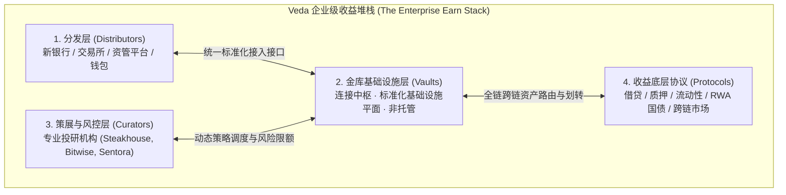
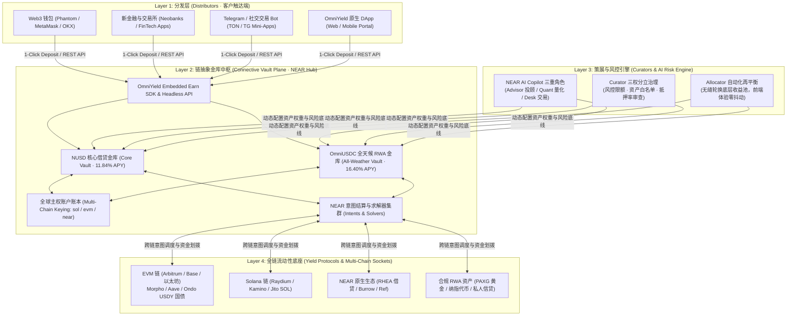
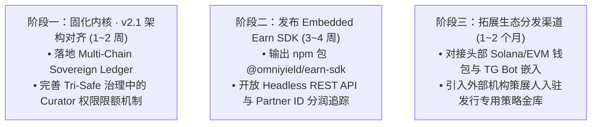

# OmniYield Protocol · 企业级全链嵌入式收益堆栈架构方案
*(The Chain-Abstracted Enterprise Earn Stack — Inspired by Veda Paradigm)*

> **报告版本**：v2.1-ENTERPRISE-PROD  
> **研究对象**：Veda 2026 年度报告《The Enterprise Earn Stack: An overview guide to embedded onchain Earn》  
> **战略定位**：**从单一的 B2C 收益聚合器，升维为面向全球金融机构与 Web3 平台的“全链嵌入式收益基础设施”（Embedded Earn-as-a-Service）**

---

## 目录
1. [Veda 报告核心精髓与行业洞察剖析](#一veda-报告核心精髓与行业洞察剖析)
2. [对 OmniYield 的五大核心启发与升维契机](#二对-omniyield-的五大核心启发与升维契机)
3. [OmniYield 新一代企业级全链收益堆栈 (4-Layer Modular Stack)](#三omniyield-新一代企业级全链收益堆栈-4-layer-modular-stack)
4. [核心产品与技术落地规范 (Technical Blueprint)](#四核心产品与技术落地规范-technical-blueprint)
5. [B2B2C 商业模式与生态分润机制 (Business & Tokenomics)](#五b2b2c-商业模式与生态分润机制-business--tokenomics)
6. [分阶段落地演进路线图 (Execution Roadmap)](#六分阶段落地演进路线图-execution-roadmap)

---

## 一、Veda 报告核心精髓与行业洞察剖析

Veda 在《The Enterprise Earn Stack》报告中提出了一套定义性的行业框架，解释了为什么机构级 Earn 市场正在经历爆发式变革：



### 1. 核心市场痛点
- **机构迫切需要 Earn，但自主搭建极其昂贵**：全球超 72% 的金融领袖认为必须提供数字资产收益产品以保持竞争力；然而，底层涉及策略研发、流动性监控、跨链集成、多链 RPC 运维、安全补丁与资金对账，**复杂度随时间呈指数级复合放大（Complexity compounds over time）**。
- **稳定币主导地位（70%）**：截至 2026 年，链上金库总市值的 70% 为稳定币（USDC/USDT），法币计价收益是进入主流零售和机构的绝对刚需。
- **“连接收益”并不难，“维护动态变化的基座”才难**：协议利率随时在变、链与链之间流动性随时迁移。机构需要的是**前端产品不变、底层策略可自由平滑轮换的基座**。

### 2. Veda 的四层解耦哲学（Separable Roles）
Veda 成功的关键在于**坚决不做垂直整合（Anti-Vertical Integration）**，而是将四大参与角色彻底解耦，各自独立演进：
1. **分发商 (Distributor)**：只负责获客与前端体验，无需关心底层合约与多链路由；
2. **金库平面 (Vault)**：扮演“结缔组织（Connective Tissue）”，提供标准化接入，保持非托管（Non-custodial）；
3. **策展人 (Curator)**：只专注风险定价与资金动态调配（如 Steakhouse、Bitwise）；
4. **底层协议 (Protocols)**：产生真实收益的去中心化市场（Aave、Morpho、Ondo 等）。

---

## 二、对 OmniYield 的五大核心启发与升维契机

对照 Veda 的企业级模型，OmniYield 协议具有天然的架构契合度，但在定位和技术输出上有巨大的**升维空间**：

| 维度 | Veda 现状 (以太坊生态) | OmniYield 当前现状 | OmniYield 借鉴后的升维优势 (Super-Power) |
| :--- | :--- | :--- | :--- |
| **底层定位** | EVM 体系内的收益金库中间件 | 面向 Retail 的 Web3 前端应用 | **升维为“全链嵌入式收益基础设施”（B2B2C Earn-as-a-Service）** |
| **跨链能力** | 依赖第三方桥或各链单独部署一套金库 | 已具备 NEAR 链抽象 + 意图 (EVM + Solana) | **利用 NEAR MPC 跨链签名，实现全球唯一原生全链聚合金库** |
| **策展机制** | 依赖线下知名机构人工调仓 | 已具备三权分立 (`curator`, `allocator`, `dao`) | **升级为“AI Agent 自主策展 + 人工机构策展”双引擎模型** |
| **分发渠道** | 机构私有接入为主 | 仅靠自身官网 `omniyield.3691618.xyz` | **推出 Embedded Earn SDK，让任意钱包、交易所、Telegram 小程序一键嵌入** |
| **结算体验** | EVM 确认慢、Gas 昂贵 | NEAR 亚秒级意图清算 + 双轨 Gas 抽象代付 | **零售端体验降维打击：0 学习成本、0 跨链桥摩擦、即存即计息** |

---

## 三、OmniYield 新一代企业级全链收益堆栈 (4-Layer Modular Stack)

借鉴 Veda 架构，我们将 OmniYield 整体拓扑升级为**标准四层企业级堆栈**：



---

## 四、核心产品与技术落地规范 (Technical Blueprint)

### 1. 推出 OmniYield Embedded Earn SDK（赋能分发商）
为新银行、加密钱包与交易终端提供极简接入包：

```typescript
// 任意 Web3 钱包或前端仅需 3 行代码即可嵌入 OmniYield 全链收益功能
import { OmniYieldEarnWidget } from "@omniyield/earn-sdk";

export function WalletEarnTab({ userAddress, chainType }) {
  return (
    <OmniYieldEarnWidget
      partnerId="partner-phantom-wealth"
      userAddress={userAddress}       // 支持 0x... 或 Solana Base58
      chain={chainType}               // "solana" | "arbitrum" | "base" | "near"
      defaultVault="all-weather"      // "usdc" (11.84%) | "all-weather" (16.40%)
      theme="dark"
      onDepositSuccess={(tx) => console.log("Yield Activated!", tx)}
    />
  );
}
```

### 2. 金库与分发商独立解耦（Separable Responsibilities）
- **分发商无托管风险**：用户资金直接通过意图存入主金库合约，分发商只获得专属的代理分润（Rebate Key），绝不触碰用户资产私钥。
- **底层调仓前端无感**：当策展人把资金从 RHEA 借贷调换至 Ondo 美债，或切换至 Solana Kamino 时，前端用户持有的 `NUSD` 或 `OmniUSDC` 份额代码、净值曲线完全连续，无需用户做任何“先取后存”的操作。

### 3. “AI 代理 + 专业机构”双轨策展（Curator Engine 升维）
借鉴 Veda 引入 Steakhouse 等机构的做法，OmniYield 设立两套策展模式：
- **AI 动态策展人 (Tri-Pillar AI Curator)**：运行在 NEAR AI Cloud 上的自主代理，实时监控链上资金费率、借贷利用率与清算风险，按天自动提交多签提案；
- **机构白标策展人 (Institutional Whitelabel Curators)**：允许知名基金或家族办公室发行专属策略子金库（Sub-Vault），并在 OmniYield 堆栈上独立设定其专属费率与准入白名单。

---

## 五、B2B2C 商业模式与生态分润机制 (Business & Tokenomics)

Veda 报告证明了 Enterprise Earn 具备极其健康的现金流变现模型：


1. **分发商收益（Distributor Fee Share）**：集成 OmniYield SDK 的钱包或交易所可按存入 TVL 抽取 0.2%~0.5% 的年化分佣，直接转化为其新盈利增长点；
2. **策展人表现费（Curator Performance Fee）**：策略超额收益的 10% 归策略制定者；
3. **协议飞轮**：随着分发商带来多链海量资金，OmniYield TVL 呈网络效应爆发，巩固 NEAR 全链清算核心地位。

---

## 六、分阶段落地演进路线图 (Execution Roadmap)



### 总结
Veda 的报告为我们指明了**从“造应用”到“做行业标准基础设施”**的战略路径。OmniYield 在拥有 **NEAR 链抽象跨链原生能力** 与 **AI Copilot** 的降维打击优势下，完全可以成为全行业最领先的 **“全链企业级 Earn 堆栈”**！
