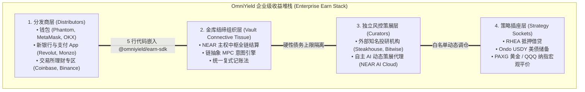
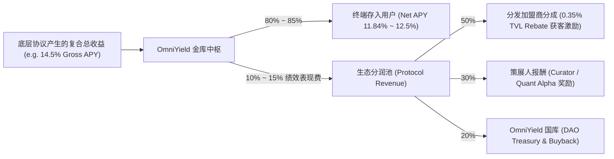
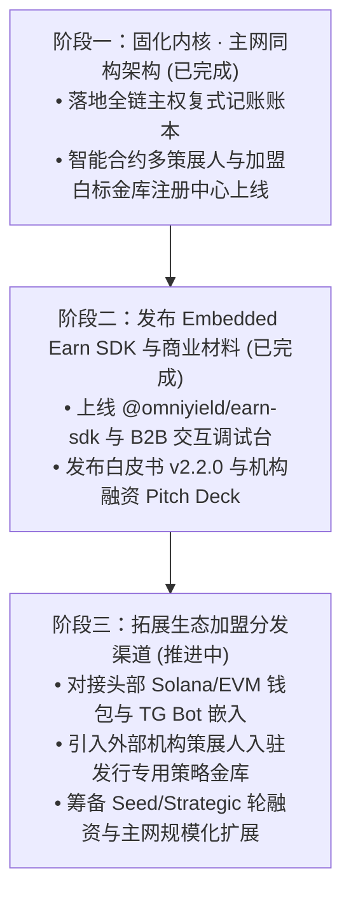

# OmniYield Protocol · 全链企业级嵌入式收益堆栈技术蓝图
*(The Chain-Abstracted Enterprise Earn Stack · Architecture Blueprint)*

> **核心定位**：全链企业级“嵌入式收益即服务”（Embedded Earn-as-a-Service）基础设施  
> **商业战略**：**自营旗舰 + TO B 赋能**（Proprietary Flagships + To-B B2B Distribution）  
> **网络拓扑**：**NEAR 链自营中枢 + 多链加盟扩张**（NEAR Sovereign Hub + Multi-Chain Franchise）  
> **编写团队**：Gosun Labs Research & Engineering  
> **发布日期**：2026 年 11 月  

---

## 目录
1. [行业演进与“自营+TO B”战略定位](#一行业演进与自营tob战略定位)
2. [NEAR 自营中枢 + 多链加盟扩张拓扑](#二near-自营中枢--多链加盟扩张拓扑)
3. [OmniYield 四层企业级收益堆栈](#三omniyield-四层企业级收益堆栈)
4. [三大关键工程实施路径](#四大关键工程实施路径)
5. [B2B2C 商业模式与生态分润机制](#五b2b2c-商业模式与生态分润机制)
6. [分阶段落地演进路线图](#六分阶段落地演进路线图)

---

## 一、行业演进与“自营+TO B”战略定位

全球链上收益赛道正在发生历史性转折：DeFi 已经走过了依赖散户手动去各 DApp 存钱的 1.0 时代。未来 1000 亿美元的链上资金增量，必然来自**嵌入式链上收益（Embedded On-Chain Earn）**——即由钱包、新银行、消费级 Web3 应用直接在其原有产品中向用户提供高息稳健理财。



### 1. 为什么“自营 + TO B”是终极制胜模型？
- **自营旗舰（Proprietary Core）**：
  - OmniYield 亲自研发、风控并运营官方旗舰金库：**$NUSD$ 核心借贷利差金库（11.84% APY）** 与 **$OmniUSDC$ 全天候 RWA 平价金库（16.40% APY）**；
  - 打造直面家族办公室、高净值用户与 DAO 国库的官方终端，并提供 **NEAR AI Copilot** 专属财富操盘服务；
  - 建立标杆级链上透明度与资金沉淀，为 TO B 赋能提供最具说服力的实盘背书。
- **TO B 赋能（B2B Infrastructure）**：
  - 将复杂的底层跨链调用、MPC 签名、清算与风控打包为成熟的 `@omniyield/earn-sdk`；
  - 赋能全球 Web3 钱包与金融机构，合作伙伴零托管风险、零技术运维，即可获得每年 **0.35% 年化 TVL 抽成**。

---

## 二、NEAR 自营中枢 + 多链加盟扩张拓扑

OmniYield 绝不采用在每个公链重复部署单机版孤岛金库的传统做法，而是采用**“主权清算中枢 + 加盟节点”**的拓扑结构：

```
                              OMNIYIELD NETWORK TOPOLOGY
                              
[Solana 加盟分销]       [Arbitrum 加盟分销]      [Base 加盟分销]      [Telegram 社交加盟]
• Phantom 钱包用户      • MetaMask 钱包用户      • Coinbase 钱包用户   • TG 迷你应用 / 聊天交易
• 接入 Kamino 策略插座   • 接入 Morpho/Aave 插座  • 接入 Aerodrome 插座 • 社交支付与小额理财
        │                        │                       │                    │
        └────────────────────────┼───────────────────────┴────────────────────┘
                                 ▼
                   ┌───────────────────────────────┐
                   │    NEAR INTENTS 链抽象意图清算  │
                   │ (无跨链桥 / 零滑点 / 协议代付 Gas)│
                   └──────────────┬────────────────┘
                                  │
                                  ▼
    ===================================================================
    ★ NEAR 链自营中枢 (SOVEREIGN SETTLEMENT HUB)
      • NEP-141 / ERC-4626 规范全局主权账本
      • 多策展人与加盟白标子金库注册中心 (Multi-Curator Registry)
      • MPC 门限签名 (v1.signer) 远程免私钥调配多链流动性
      • Tri-Safe 三权分立多签治理与 24 小时链上强制时间锁
    ===================================================================
```

1. **NEAR 链自营中枢（Sovereign Hub）**：全局唯一的权威份额账本、双金库宏观配比、策展人额度配给、时间锁与防通胀虚拟偏移计算，全部安全沉淀于 NEAR 主网。
2. **多链加盟体系（Multi-Chain Franchise）**：Solana、EVM 各链作为“分销加盟商”接入，用户在其习惯的原生钱包即可一键完成存取，底层资产通过 Solver 极速清算至 NEAR 核心，零滑点、零假币、无包裹资产风险。

---

## 三、OmniYield 四层企业级收益堆栈

对照现代化金融基础设施架构，OmniYield 将收益全生命周期解耦为四大标准层：

### 1. 分发层（Distributor Layer）：极简嵌入与自动化分润
- **分发商无托管风险**：终端用户资金直接通过链抽象意图存入智能合约，分发商只获得专属的代理分润（`Partner ID`），绝不触碰用户私钥；
- **全平台支持**：提供 React Widget、轻量 HTML Script 嵌入标签、Headless REST API 与 Telegram Mini-App 适配方案。

### 2. 金库结缔组织层（Vault Connective Tissue）：NEAR 链抽象中枢
- **双金库矩阵运作**：
  - **NUSD 核心借贷金库**（70% RHEA 抵押借贷 + 30% Ondo USDY 美债缓冲）；
  - **OmniUSDC 全天候 RWA 金库**（借贷 40% + 美债 30% + 黄金 PAXG 15% + 纳指 QQQ 15%）。
- **底层调仓前端无感**：当策略在底层协议间再平衡时，前端份额净值平滑上涨，无需用户手动赎回或重新质押。

### 3. 策展与风控层（Curation & Risk Layer）：多策展人与加盟子金库
- **自主 AI 动态策展人**：运行在 NEAR AI Cloud 上的自主量化代理，监控全球借贷利差与清算风险，按天提交最优配比提案；
- **机构白标加盟策展人**：允许知名基金（如 Steakhouse、Bitwise）发行专属加盟子金库（Sub-Vault），独立拥有硬性债务上限（`max_debt_ceiling`）与策略白名单，彻底隔离风险。

### 4. 策略插座层（Strategy Sockets）：可插拔黑盒引擎
- 任何经过安全验证的借贷池、现实世界资产（RWA）国债、跨链流动性池，均可封装为符合标准化接口的 `OmniSocket™`，由治理委员会一键挂载接入。

---

## 四、三大关键工程实施路径

### 路径 A：发布 `@omniyield/earn-sdk` 嵌入式组件与开发者中心（已交付）
- 在官网设立 **`企业接入 (B2B SDK)`** 专属模块；
- 提供 Live Widget Simulator 实时调试台与四端代码生成器；
- 上线分发商收益测算器，动态测算每年 0.35% 的净分润现金流。

### 路径 B：升级智能合约多策展人与加盟白标金库机制（已交付）
- 在 NEAR 核心合约实现 `CuratorConfig` 与 `WhitelabelSubVault` 注册中心；
- 实施硬性隔离不变性：每个子金库拥有独立 `max_debt_ceiling`，杜绝策略交叉违约；
- 在机构治理后台上线 Section 1.6 **`机构多策展人与加盟子金库注册中心`**，集成一键应急熔断开关。

### 路径 C：升级项目白皮书与机构融资商业材料（已交付）
- 全面升维技术白皮书至 **v2.2.0**，确立自主企业级架构与全链复式记账法；
- 发布 **机构融资商业 Pitch Deck (`docs/INSTITUTIONAL_PITCH_DECK.md`)**，提炼单车经济学与 \$2.5M 融资规划。

---

## 五、B2B2C 商业模式与生态分润机制

OmniYield 确立了极具自我造血能力的健康现金流变现模型：



1. **分发商加盟分润（Distributor Fee Share）**：集成 OmniYield SDK 的钱包或交易所可按存入 TVL 抽取 0.35% 的年化分佣；
2. **策展人表现费（Curator Performance Fee）**：策略超额收益的 30% 归策略制定者；
3. **协议飞轮**：随着分发商带来多链海量资金，OmniYield TVL 呈网络效应爆发，巩固 NEAR 全链清算核心地位。

---

## 六、分阶段落地演进路线图



### 总结
OmniYield 坚持**“自营做标杆，TO B 做规模；NEAR 做中枢，多链做加盟”**的战略蓝图。在拥有 **NEAR 链抽象跨链原生能力** 与 **AI Copilot** 的降维打击优势下，OmniYield 正在成为全行业最领先的 **“全链企业级 Earn 堆栈”**！
