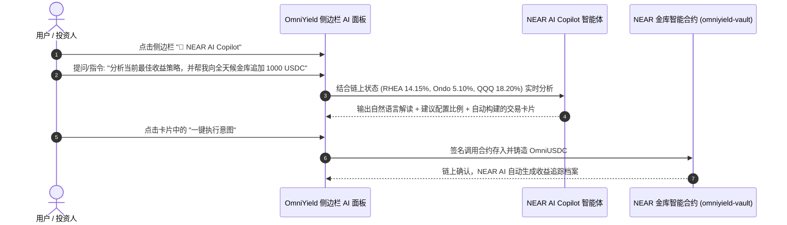

# OmniYield Protocol：左侧边栏布局重构与 NEAR AI 深度融合方案
## Modern Left-Sidebar Layout & Native NEAR AI Copilot Integration Architecture

---

> **设计核心思想**：  
> 融合 **X (Twitter) 的极简信息流与 Grok 智能体入口**、**Rhea Finance 的专业 DeFi 侧边栏折叠交互**，以及 **Gemini 的 AI 对话与知识库侧边栏体验**；  
> 彻底将 OmniYield 从传统的“顶部导航+单一垂直滚动页面”，升格为 **“全天候专业资产管理终端 + NEAR AI 智能投顾大脑”**！

---

## 一、三者设计精髓与 OmniYield 融合矩阵

```mermaid
flowchart LR
    X["X (Twitter) 侧边栏<br/>• 极简大图标+文字<br/>• 专属 AI 入口 (Grok)<br/>• 底部账号卡片 (Profile)"] --> Hybrid["OmniYield 新一代左侧边栏架构"]
    Rhea["Rhea Finance 侧边栏<br/>• 专业 DeFi 折叠展开 (&lt;&lt;)<br/>• 业务模块清晰分区<br/>• 极客暗黑质感"] --> Hybrid
    Gemini["Gemini 侧边栏<br/>• 发起新对话快捷按钮<br/>• 历史分析与策略库<br/>• 智能体常驻交互"] --> Hybrid

    Hybrid --> Output["现代化 Web3 资产终端 + NEAR AI Copilot"]

    style Hybrid fill:#0f172a,stroke:#10b981,stroke-width:2px;
    style Output fill:#022c22,stroke:#06b6d4,stroke-width:2px;
```



| 借鉴来源 | 核心优势 | 在 OmniYield 中的落地形式 |
| :--- | :--- | :--- |
| **X (Twitter)** | 标志性竖向导航、**Grok AI 独立高亮入口**、底部个人账号卡片 | **左侧竖向主导航 + 机器人智能体专区 + 底部 GOSUN 机构身份/钱包卡片** |
| **Rhea Finance** | 专业 DeFi 紧凑菜单、折叠/展开按钮（`<<`）、沉浸式暗黑科技感 | **支持宽版展开 / 极简图标折叠（Mini 模式），为主图表腾出极致空间** |
| **Google Gemini** | “发起新对话”大药丸按钮、策略/知识库分类、AI 对话流抽屉 | **“🤖 NEAR AI 智能调仓与问答”抽屉，可随时呼出分析金库、意图下达指令** |

---

## 二、页面整体视窗架构（Layout Architecture）

从原有的 **“顶部导航 + 单栏垂直流”**，重构成标准的 **“双栏/三栏响应式工作台（Dashboard Workbench）”**：

```
┌───────────────────────────────────────────────────────────────────────────────────────────────────────┐
│ OmniYield Protocol 工作台视窗                                                                          │
├─────────────────────┬─────────────────────────────────────────────────────────────────────────────────┤
│ 左侧边栏 (Sidebar)   │ 主视窗区域 (Main Viewport)                                                       │
│ 宽: 260px (折叠:72px)│                                                                                 │
│                     │ ┌─ 顶部轻量状态栏 ────────────────────────────────────────────────────────────┐  │
│ [🟢 OmniYield Logo] │ │ 🌐 多链意图清算网络 • NEAR Testnet • 🛡️ 多签安全舱 (1 笔待审 🔴) • 🌙/🌐 主题 │  │
│ [<< 折叠切换按钮]   │ └─────────────────────────────────────────────────────────────────────────────┘  │
│                     │                                                                                 │
│ ── 核心金库 ─────── │ ┌─ 动态视图主内容区 (根据左侧切换) ───────────────────────────────────────────┐  │
│ 🏦 金库大厅 (Vaults) │ │                                                                             │  │
│   • 🟢 NUSD 核心金库│ │  【视图 A：金库主面板 (Vaults)】                                             │  │
│   • 🔵 OmniUSDC全天候│ │  - 双金库核心指标看板 (APY / TVL / 净值)                                     │  │
│ 📊 收益市场 (Markets)│ │  - 达里奥宏观平价 4 资产 (美股/美债/黄金/借贷)                                │  │
│ ⚡ 跨链意图 (Bridge) │ │  - 智能存入/赎回操作舱 (EVM/Solana/NEAR 零 Gas 存取)                         │  │
│                     │ │                                                                             │  │
│ ── NEAR AI 投顾 ─── │ │  【视图 B：NEAR AI 智能体工作台 (Copilot)】                                   │  │
│ 🤖 NEAR AI Copilot  │ │  - 类似 Gemini 的全屏/半屏对话流                                             │  │
│    [+ 问答/调仓]     │ │  - 实时分析 RHEA 与 Ondo 利率、一键触发 reallocate() 调仓                     │  │
│ 📈 宏观分析 (Reports)│ │                                                                             │  │
│                     │ │  【视图 C：治理与三多签 (Multi-Sig Safe)】                                    │  │
│ ── 治理与机构 ───── │ │  - 协议安全多签 + DAO 财务金库 + Base 调度多签操作面板                       │  │
│ 🏛️ 多签安全 (Safe 🔴)│ └─────────────────────────────────────────────────────────────────────────────┘  │
│ 💼 资产档案 (Assets) │                                                                                 │
│                     │                                                                                 │
│ ── 底部个人卡片 ─── │                                                                                 │
│ [🟡 GOSUN Capital]  │                                                                                 │
│  dao.omniyield...   │                                                                                 │
│  3.88 N | $8 USDC   │                                                                                 │
└─────────────────────┴─────────────────────────────────────────────────────────────────────────────────┘
```

---

## 三、左侧边栏核心信息架构规划（Information Architecture）

### 1. 顶部品牌区（Header Brand）
- **OmniYield Logo**：动态呼吸发光标志。
- **协议名称与版本**：`OmniYield v1.0 • NEAR Main`。
- **侧边栏折叠按钮（`<<` / `>>`）**：
  - 展开状态：显示完整文字与徽标；
  - 折叠状态：只保留高精致度图标（Tooltip 悬停提示），节省屏幕空间给行情与图表。

### 2. 第一分区：核心金库与资产（Core Vaults & DeFi）
- **🏦 金库主页 (Vaults Dashboard)**：
  - 子菜单一键直达：
    - 🟢 **GOSUN OmniYield USDC**（11.84% APY • 产出凭证 **`NUSD`**）
    - 🔵 **GOSUN All-Weather RWA**（16.40% APY • 产出凭证 **`OmniUSDC`**）
- **📊 收益市场 (Dynamic Markets)**：
  - 直接查看 RHEA 借贷池、Ondo 美债、美股 QQQ、黄金 PAXG 独立状态与 Supply Cap 额度。
- **⚡ 跨链意图流 (Cross-Chain Intents)**：
  - 查看 Arbitrum、Base、Solana 跨链出入金实时撮合与 Solver 凭证。

### 3. 第二分区：NEAR AI 投顾专区（借鉴 X 的 Grok + Gemini 体验）
- **✨ 发起 AI 咨询与调仓按钮（+ New AI Session）**：
  - 高亮发光按钮（类似 Gemini 的“发起新对话”），点击直接唤起 NEAR AI Copilot。
- **🤖 NEAR AI Copilot 智能助手**：
  - 核心功能：
    - **宏观收益问答**：“为什么今天推荐全天候金库？”“现在的加权 APY 是如何计算的？”
    - **风险监控解读**：“检查 RHEA 借贷池利用率与脱锚风险”；
    - **意图指令执行**：“帮我调仓 500 USDC 到美债储备”、“触发一次 reallocate() 并生成链上证明”。
- **📑 AI 研报与市场洞察 (AI Insights & Reports)**：
  - 自动生成的达里奥宏观平价策略周报、美联储降息对 Ondo USDY 的收益影响分析。

### 4. 第三分区：治理与安全（Governance & Multi-Sig）
- **🏛️ 三多签安全舱 (Tri-Safe Multi-Sig Cockpit)**：
  - 按钮右侧带 **呼吸红点 🔴（待签提案计数）**；
  - 点击直达管理后台：
    - 协议安全多签 (Protocol Security Safe)
    - DAO 财务金库 (DAO Treasury Safe)
    - Base 跨链调度多签 (Base Dispatcher Safe)
- **💼 我的投资组合 (Portfolio & Holdings)**：
  - 汇总查看用户持有的 `NUSD` 与 `OmniUSDC` 累计收益与历史记录。

### 5. 底部卡片：机构账户与身份（借鉴 X 的 Profile Card）
- 位于侧边栏最底部，固定展示：
  - **头像/图标**：GOSUN Capital 徽标；
  - **当前连接账户**：`dao.omniyield-vault.testnet`；
  - **资产速览**：`3.88 NEAR` | `$8 USDC`；
  - **操作**：点击弹出钱包抽屉（切换账户、断开连接、领取 5,000 USDC 水龙头）。

---

## 四、NEAR AI 深度融合技术方案（NEAR AI Fusion）

NEAR 联合创始人 Illia Polosukhin 是现代大模型 Transformer 论文作者，NEAR 官方正全力打造 **User-Owned AI 与链上 AI Agent（智能体）生态**。我们在 OmniYield 中深度融合 NEAR AI，具有极高的黑客松获奖杀伤力！



### 1. NEAR AI 智能体三层能力矩阵：
1. **感知层（Information Perception）**：
   - 实时读取金库链上数据：RHEA 利率、Ondo 净值、金库当前 TVL、Supply Cap 使用率。
2. **决策与解释层（Reasoning & Explanation）**：
   - 将复杂的金融工程（如桥水达里奥四维平价模型、加权 APY 计算、夏普比率）翻译为普通人听得懂的投资建议。
3. **行动与执行层（Action Execution via NEAR Intents）**：
   - AI 不仅能“聊”，还能生成“可执行操作卡片”；
   - 用户只需点击卡片，即可一键触发存入、赎回或 AI 调仓 `reallocate()`。

---

## 五、改造成果对比一览

| 维度 | 改造前（现有顶栏布局） | 改造后（全新侧边栏 + NEAR AI 布局） |
| :--- | :--- | :--- |
| **页面视野** | 顶部顶栏占用高度，内容纵向不断滚动 | **左侧纵向收纳，主区域宽屏沉浸式展现图表与市场** |
| **功能扩展性** | 顶栏按钮数量受限，双金库/多签拥挤 | **侧边栏结构清晰无限扩展，支持二级收折与分栏** |
| **AI 属性** | 无 AI 交互入口，纯依靠后台 Keeper 跑代码 | **常驻 NEAR AI Copilot，秒变具备人机协同的智能资管终端** |
| **视觉档次** | 常规 DeFi 网页 | **媲美 X (Twitter) + Rhea + Gemini 的下一代专业级金融工具** |
| **黑客松契合度** | 涵盖意图与链签名 | **意图 + 链签名 + NEAR AI 智能体“三位一体”，夺奖顶配阵容！** |

---

## 六、下一步实施落地路线

如果您确认该方案，我们将分步进行无缝重构（保障所有已跑通的链上多签、双金库、跨链意图完全不受影响）：
1. **第一阶段：搭建响应式左侧边栏骨架**（支持折叠/展开、图标+文字、高亮当前路由）；
2. **第二阶段：将现有双金库（NUSD / OmniUSDC）与市场卡片平移至主视窗内容区**；
3. **第三阶段：嵌入 NEAR AI Copilot 对话交互抽屉与智能问答引擎**；
4. **第四阶段：将底部个人资料卡与双金库四格钱包抽屉紧密联动**。

方案已正式入库，请您审阅。确认后回复 **“实施”**，我们立即启动侧边栏与 NEAR AI 的编程落地！

