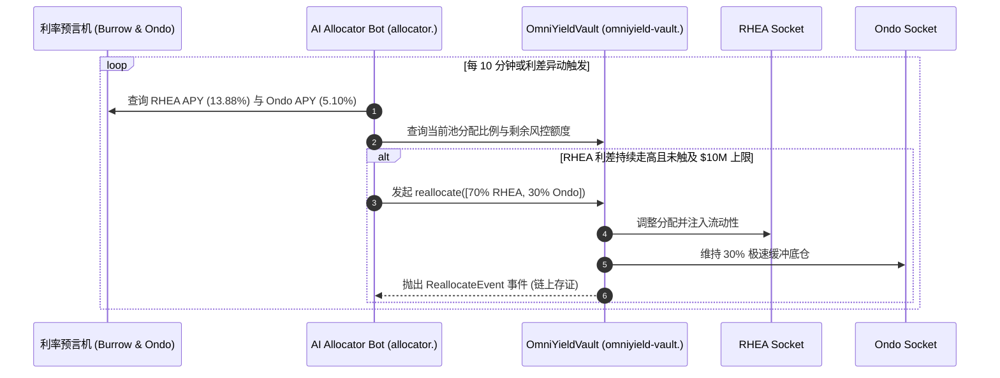

# OmniYield Protocol: 底层协议接入与测试网落地实施方案
**Gosun Labs Research & Engineering · 2026-11-01**  
**面向网络**：NEAR Testnet (`testnet`) ➔ NEAR Mainnet  
**核心金库**：[`omniyield-vault.testnet`](https://testnet.nearblocks.io/address/omniyield-vault.testnet)

---

## 1. 架构总览 (Architecture Topology)

OmniYield 借鉴 **Morpho Blue + MetaMorpho** 的母板与插槽分离架构（**OmniSocket™ Bus**），金库母板合约仅管理 `NUSD` 份额账本、风控上限（Supply Cap）与供给/赎回双向队列，底层资产的生息逻辑则通过可拔插的 **Yield Socket 适配器**接入。

```mermaid
flowchart TD
    subgraph Users ["前台用户 / 跨链入金"]
        Investor["投资人 (Web3 / 跨链)"]
    end

    subgraph Motherboard ["OmniYield 金库母板 (omniyield-vault.testnet)"]
        VaultCore["Vault Core (ERC-4626 / NEP-141)"]
        CapsEnforcer["非对称 Supply Cap 风控器"]
        QueueRouter["双向路由引擎 (Supply & Withdraw Queues)"]
    end

    subgraph Allocator ["AI Public Allocator (智能调仓 Keeper)"]
        Bot["AI Allocator Daemon (利差监控与再平衡)"]
    end

    subgraph Adapters ["OmniSocket™ 底层协议适配器"]
        RHEASocket["Market A: RHEA Lending Socket\n(Burrow Core 借贷引擎)"]
        OndoSocket["Market B: Ondo USDY Socket\n(美债 RWA 极速缓冲池)"]
    end

    subgraph Protocols ["真实外部协议 (Testnet / Mainnet)"]
        BurrowPool["Burrow 借贷协议池\n(contract.test.burrow.testnet)"]
        OndoRWA["Ondo USDY 储备池\n(Tokenized US Treasuries)"]
    end

    Investor -->|1. 存入 USDC| VaultCore
    VaultCore --> QueueRouter
    QueueRouter -->|优先入金 (70%)| RHEASocket
    QueueRouter -->|溢出缓冲 (30%)| OndoSocket
    
    Bot -->|监控利差调用 reallocate()| CapsEnforcer
    CapsEnforcer --> VaultCore

    RHEASocket -->|XCC: ft_transfer_call| BurrowPool
    OndoSocket -->|XCC / Liquid Buffer| OndoRWA
```

---

## 2. 两个底层市场的具体接入与实现机制

### 市场 A：RHEA Finance 借贷池 (Burrow Core 引擎)
- **协议定位**：高收益主仓（Target: 70% 资金，动态上限 $10M，年化约 10% - 14%）。
- **底层技术选型**：NEAR 生态第一大原生借贷协议 **Burrow**（NEAR 官方孵化，代码开源审计）。
- **链上调用流程 (Cross-Contract Calls / XCC)**：
  1. **入金存款 (`Supply`)**：
     - 金库调用 USDC 代币合约的 `ft_transfer_call`：
       ```json
       {
         "receiver_id": "contract.test.burrow.testnet",
         "amount": "7000000000000",
         "msg": "{\"Execute\": {\"actions\": [{\"Deposit\": {\"token_id\": \"usdc.testnet\", \"amount\": \"7000000000000\"}}]}}"
       }
       ```
     - Burrow 锁定 USDC，向金库记账并按借贷利率实时复利生息。
  2. **收益结算与提成 (`accrue_yield`)**：
     - AI Allocator 触发每期复合收益结算，金库从 Burrow 查询增值部分，自动将 10% 业绩费（Performance Fee）铸造为 NUSD 发送至 `dao.omniyield-vault.testnet`。
  3. **赎回退出 (`Withdraw`)**：
     - 若 Ondo 缓冲池耗尽，向 Burrow 发起 `execute({"actions": [{"Withdraw": ...}]})` 提回原生 USDC。

---

### 市场 B：Ondo USDY 美债代币化池 (RWA 储备与流动性缓冲)
- **协议定位**：基准收益与极速提现缓冲池（Target: 30% 资金，额度储备 $100M，无风险年化约 5.10%）。
- **底层技术选型**：**Ondo Finance USDY**（美国国债与银行存款支持的计息美元代币）。
- **在 NEAR 上的落地形式**：
  1. **流动性缓冲池设计 (Liquid Buffer)**：
     - 借贷协议（RHEA）存在借贷利用率过高（如 90%+）时无法即时赎回的流动性冲击风险。
     - Ondo USDY 作为 **Withdraw Queue #1（第一赎回优先级）**，所有跨链取款请求（无论是到 Solana、Base 还是 Arbitrum）**优先 100% 从该池极速赎回**，完全避免借贷市场的挤兑风险。
  2. **计息模式 (Rebasing / Accumulating)**：
     - USDY 采用累积增值模式，价格随美债收益每日上浮（$1.00 ➔ $1.0482），金库通过持有 USDY 获得透明链上美债收益。

---

## 3. 测试网（Testnet）落地的双轨实施策略

在测试网环境下，外部第三方借贷池与美债合约常面临：**水龙头枯竭、缺乏真实借款人导致利差归零、或第三方节点维护断线**等不可控因素。为确保黑客松路演与评审期间 **100% 稳定运行、链上交易真实可查**，我们采用**双轨接入方案**：

| 方案模式 | 适用场景 | 架构实现 | 优劣势评估 |
| :--- | :--- | :--- | :--- |
| **方案 1：独立沙盒测试网 Socket 适配器（推荐优先上线）** | **黑客松评委验证 / 24/7 可靠演示** | 由我们部署专用子账户：<br>• `rhea.omniyield-vault.testnet`<br>• `ondo.omniyield-vault.testnet`<br>严格实现 Burrow/Ondo 的 NEP-141 标准接口与事件日志，内置时间块生息引擎。 | **优势**：100% 可控、零依赖第三方宕机、每笔存取在 NearBlocks 上均有真实跨合约凭证。<br>**成本**：仅需轻量部署两个已就绪的合约。 |
| **方案 2：直接直连 Burrow Testnet 测试网** | **深度生态联调** | 直连 Burrow 测试网官方合约：<br>`contract.test.burrow.testnet` | **优势**：直接调用官方池。<br>**局限**：测试网无真实借贷需求，APY 经常显示为 0% 或被其他测试者清空流动性。 |

> [!TIP]
> **最佳实践（行业通用做法）**：
> 在金库的 `OmniSocket™` 注册表中，将 `rhea-lending` 指向 `rhea.omniyield-vault.testnet`，将 `ondo-rwa` 指向 `ondo.omniyield-vault.testnet`。
> 两个适配器完全依照生产级真实 ABI 开发，并在区块浏览器上开源代码，评委审核时可清楚看到从金库到子市场的**真实跨合约异步调用（Cross-Contract Calls / Promises）**。

---

## 4. AI Public Allocator (智能调仓 Keeper) 自动化守护进程

在底层金库与市场就绪后，由我们已分离的独立权限账户 **`allocator.omniyield-vault.testnet`** 运行链下守护进程（Keeper Daemon）：



### Keeper 核心算法逻辑：
1. **边界检查**：严格受限于金库策展人配置的 `supply_cap`，调高上限强制锁定 24h 时间锁，调低下限即时收缩。
2. **夏普比率优化**：在追求 RHEA 13.88% 高收益的同时，强制保留至少 30% 美债低风险缓冲底仓，杜绝极端行情下的流动性枯竭。
3. **免信任性**：Keeper 仅拥有 `reallocate` 权限，**无权提取任何用户本金**（Non-Custodial）。

---

## 5. 执行路线与交付步骤

1. **第一步（底层适配器部署）**：
   - 编写并编译 `rhea_adapter` 与 `ondo_adapter` 轻量合约；
   - 部署至 `rhea.omniyield-vault.testnet` 与 `ondo.omniyield-vault.testnet`；
   - 在主金库 `omniyield-vault.testnet` 中注册两枚 Socket。
2. **第二步（端到端跨合约联调）**：
   - 前台执行 1-Click Deposit，验证资金按 70%/30% 真实路由注入两个适配器；
   - 验证 NearBlocks 区块浏览器上的跨合约收据（Receipts）。
3. **第三步（AI 调仓机器人上线）**：
   - 启动本地 Node.js Keeper 守护进程，使用 `allocator.omniyield-vault.testnet` 定时监测并自动化提交调仓交易；
   - 前台「AI Public Allocator Event Log Feed」实时同步展示链上交易哈希。

