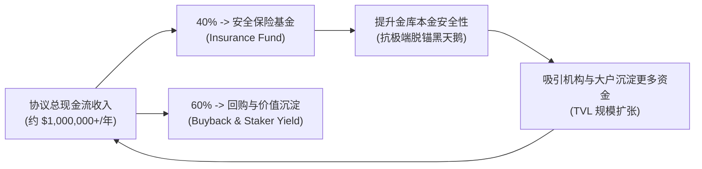

# OmniYield Protocol: 代币经济学与商业模式
> **Tokenomics & Business Model Specification**  
> **核心资产：** `NUSD` (NEAR Yield Dollar)  
> **设计目标：** 拒绝空气补贴，打造具备真实现金流（Real Revenue）的去中心化自循环金融商业体

---

## 一、 核心资产：`NUSD` 的金融属性

`NUSD` 是由 OmniYield 协议基于真实抵押物（USDC/USDT）铸造的**生息型收益代币（Yield-Bearing Dollar）**：

1. **净值增长型模型（Appreciating Share Model）**：
   * 采用类似 Compound cToken / Rocket Pool rETH 的份额净值机制；
   * 用户存入 1,000 USDC，最初获得 1,000 个 `NUSD`（净值 \$1.0000）；
   * 随着底层 RHEA 借贷与美债利息的持续沉淀，金库 `total_assets` 持续增加，而 `total_shares` 保持稳定；
   * 一年后 `NUSD` 的净值增长至例如 \$1.1184，用户赎回时销毁 1,000 个 `NUSD`，即可直接取回 1,118.4 个 USDC！
2. **全生态流动性与抵押品属性**：
   * `NUSD` 完全符合 NEAR 原生 **NEP-141 标准**，可直接作为优质生息抵押品存入其他借贷市场，或在 Ref Finance 组建 `NUSD / USDC` 超级稳定币流动性池。

---

## 二、 协议三大现金流造血引擎 (Revenue Streams)

OmniYield 的收入来自对沉淀资金的高效资产管理与跨链撮合服务，现金流透明清晰：

```
+-----------------------------------------------------------------------------------------+
|                              OmniYield 协议收益结构与费率模型                           |
+-----------------------+-----------------------+-----------------------------------------+
| 收入类型              | 计费比例              | 预计年化创收 (按 $50M TVL 计算)         |
+-----------------------+-----------------------+-----------------------------------------+
| ① 资产管理费 (Mgmt Fee)| 0.50% / 年 (按区块计提) | $250,000 / 年 (极稳定的运营底仓收入)    |
| ② 收益提成 (Perf Fee)  | 10.0% (仅对利息部分计提)| $500,000 - $700,000 / 年 (顺周期高收益) |
| ③ 跨链意图撮合清算分成 | 0.02% / 单次存取      | $100,000 / 年 (随交易频次增长)          |
+-----------------------+-----------------------+-----------------------------------------+
| 协议年度预计净现金流 (Annual Protocol Revenue):               $850,000 - $1,050,000 / 年|
+-----------------------------------------------------------------------------------------+
```

---

## 三、 价值捕获与安全飞轮 (The Economic Flywheel)

协议赚取的净利润按固定智能合约规则进行分流，形成自我强化的正向飞轮：



1. **40% 注入安全保险基金 (Insurance Reserve)**：
   * 独立存放在链上多签隔离金库中，专用于在极端黑天鹅脱锚事件中兜底赔付，保护散户与机构本金安全；
2. **60% 价值捕获 (Buyback & Community Dividends)**：
   * 在二级市场持续回购治理代币，或直接以 USDC 形式派发给长期质押者，实现真实收益闭环（Real Yield Distribution）。

