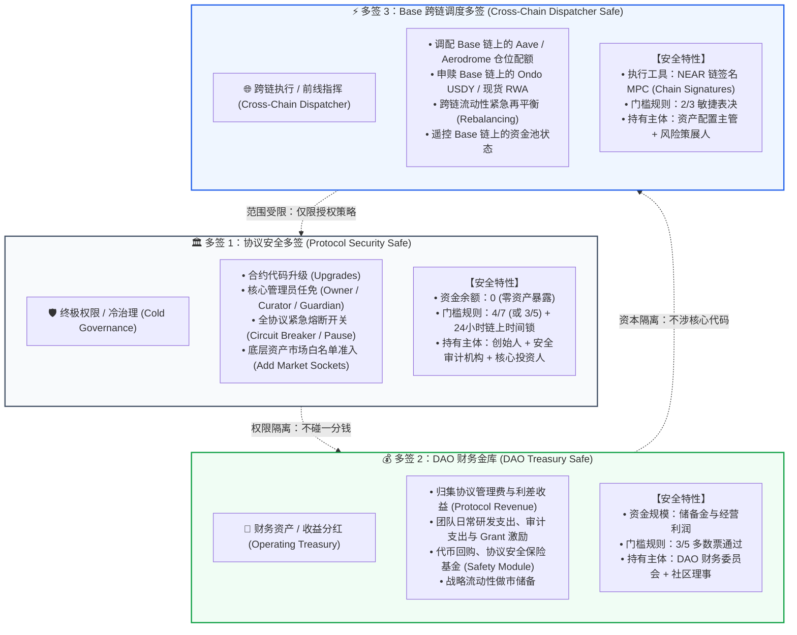

# OmniYield Protocol：三多签矩阵治理架构方案
## Tri-Safe Multi-Sig Governance Architecture Specification

---

> **核心原则：权限、资本与跨链调度的彻底解耦（Separation of Powers, Capital & Cross-Chain Execution）**  
> 杜绝任何单私钥（Single EOA Private Key）存在的单点故障与泄密隐患；实现“日常业务全自动，高危特权全多签，跨链调度全链签”。

---

## 一、架构总览与治理哲学

在去中心化金融（DeFi）与现实世界资产（RWA）资管协议中，治理失败与私钥泄露是 90% 以上资产损失的根源。OmniYield Protocol 彻底摒弃传统“单多签一把抓”或“单一私钥部署”的草台班子模式，采用国际顶级机构标准（如 MakerDAO / Uniswap / Morpho）的 **「三多签矩阵架构（Tri-Safe Architecture）」**：



---

## 二、三大多签核心权责与技术定义

### 1. 多签 1：协议安全与权限金库 (Protocol Security Safe)
- **定位**：最高安全防线，掌管协议生杀大权。
- **NEAR 账户命名**：`security.omniyield.sputnik-dao.near` (测试网：`security.omniyield-vault.testnet`)
- **合约映射**：
  - `vault.owner_id`: 最高合约所有者
  - `vault.guardian_id`: 紧急状态熔断者
- **核心操作集**：
  1. `set_timelock_duration()`: 修改提议生效时间锁。
  2. `upgrade_contract_code()`: 合约代码热升级。
  3. `add_market_socket()`: 批准接入新的收益市场（如美股、黄金）。
  4. `pause()` / `unpause()`: 遭遇极端黑天鹅时的紧急熔断。
- **治理策略**：
  - **4/7** 或 **3/5** 签名门槛。
  - 强制绑定 **24 小时链上时间锁（Timelock）**：任何涉及代码升级或敏感参数变动的提案，经多签投票通过后，必须在链上公开倒计时 24 小时，给储户与社区充足的审查时间，真正实现“无 Rug Pull”。

---

### 2. 多签 2：DAO 财务与收益金库 (DAO Treasury Safe)
- **定位**：协议财富中枢与收益分发中心。
- **NEAR 账户命名**：`treasury.omniyield.sputnik-dao.near` (测试网：`treasury.omniyield-vault.testnet`)
- **合约映射**：
  - `vault.fee_recipient`: 协议管理费与绩效费的唯一法定接收地址。
- **核心操作集**：
  1. 接收金库每秒自动计提的 **10% 收益提成（Performance Fees）**。
  2. 向外部合作方、做市商、安全审计公司划转项目款。
  3. 分发团队研发预算、生态开发者 Grant。
  4. 启动储备金回购机制。
- **治理策略**：
  - **3/5** 多数决。
  - 接入自动化报表与透明审计，每一笔支出在链上具有可查的 Proposal 理由。

---

### 3. 多签 3：Base 跨链执行与调度多签 (Cross-Chain Dispatcher Safe)
- **定位**：跨链指挥官，前线资金调度中心。
- **NEAR 账户命名**：`base-dispatcher.omniyield.sputnik-dao.near` (测试网：`dispatcher.omniyield-vault.testnet`)
- **核心操作集**：
  1. 调整 Base 链与 NEAR 链之间的资金储备分配比例。
  2. 签署 Base 链上的 Aave V3 存款/取款指令。
  3. 执行 Base 链上的 Ondo USDY 申购/赎回。
  4. 协调 Solver 跨链做市池的头寸再平衡。
- **治理策略与前沿黑科技（NEAR Chain Signatures MPC）**：
  - **2/3** 敏捷表决，确保在市场波动时数十分钟内完成调度。
  - **无助记词、全链遥控**：多签成员无需持有 Base 链私钥或储备 Base ETH 作为 Gas。在 NEAR 上通过 `v1.signer` 请求派生 Base EVM 地址：
    $$\text{Base\_Address} = \text{DeriveAddress}(\text{base-dispatcher.omniyield.sputnik-dao.near}, \text{path})$$
  - 一旦 2/3 理事批准，NEAR 去中心化 MPC 节点直接广播已签名的 EVM 原生交易至 Base 网络！

---

## 三、三大多签核心参数对比矩阵

| 维度 | 多签 1：协议安全 Safe | 多签 2：DAO 财务 Safe | 多签 3：Base 调度 Safe |
| :--- | :--- | :--- | :--- |
| **首要目标** | 协议底层不可被篡改与攻击 | 协议财务健康与收益透明 | 外部链资产收益最大化与流动性调拨 |
| **账户资金暴露** | **0 USDC**（零资产暴露） | **大量**（经营利润与储备资金） | **受限**（仅限正在调度的外部头寸） |
| **触发频次** | **极低频**（数月一次） | **中低频**（按周/按月常规划拨） | **中高频**（视市场利率动态调整） |
| **通过阈值** | **4 / 7** (高门槛) | **3 / 5** (稳健多数) | **2 / 3** (敏捷表决) |
| **时间锁机制** | **24 小时链上强制公示** | 无（或 2 小时紧急缓冲） | **无时间锁**（秒级/分钟级执行） |
| **底层技术** | SputnikDAO v2 + Timelock | Trezu / SputnikDAO Treasury | NEAR Chain Signatures (MPC `v1.signer`) |
| **主要成员** | 核心创始人、代码审计员、机构合伙人 | 财务官、运营主管、社区代表 | 风险策展人 (Curator)、资产管理调度员 |

---

## 四、双轨落地实施方案（测试网 vs 主网）

### 1. 运行模式与私钥保留规范（研发演示 vs 生产上线）
> [!NOTE]
> **研发与演示阶段（Demonstration & Staging Mode）**：  
> 当前阶段为保障原型测试、功能迭代与调试响应速度，系统**底层保留多签成员备份私钥，不执行物理删除**。  
> **主网生产阶段（Production Keyless Mode）**：  
> 经安全审计与终审后，一键执行链上 `delete-key` 指令彻底物理抹除初始私钥，平滑切换为 100% 纯代码零私钥治理。

### 2. 双轨并行通知系统（Notification Scheme 2 & 3 Parallel System）
为确保多签成员秒级获悉待办提案，系统同时启用双轨通知：
1. **方案二：Web3 移动钱包锁屏推送（Mobile Wallet Push）**：
   - 监听 `dao.omniyield-vault.testnet` 链上 `ProposalCreated` 事件。
   - 自动向理事成员绑定的 HERE Wallet、Meteor Wallet 及 Web3Inbox 发送即时锁屏横幅通知。
2. **方案三：前端常驻呼吸红点待办指示器（In-App Live Breathing Red Badge）**：
   - 官网导航栏与网页背面多签安全舱内置实时感应器，定时轮询链上待办提案数。
   - 存在待办时触发红点呼吸动画（`🔴 1 笔多签待审批`），点击直达背面控制台一键签名。

### 3. 主网路径（生产环境：Trezu + SputnikDAO）
- **工具**：生态顶级平台 **Trezu** (`trezu.app`)。
- **免 Gas 部署**：利用 Trezu 的“Setup is on us”全额赞助，直接在主网注册：
  1. `security.omniyield.sputnik-dao.near`
  2. `treasury.omniyield.sputnik-dao.near`
  3. `base-dispatcher.omniyield.sputnik-dao.near`
- **一站式管理**：在 Trezu 可视化面板中直接完成 Council 成员公钥录入、权限配置与跨链地址派生。

### 2. 测试网路径（黑客松评审与环境验证）
- **控制账户**：[`dao.omniyield-vault.testnet`](https://testnet.nearblocks.io/address/dao.omniyield-vault.testnet)
- **多签合约源码**：[`contracts/multisig/src/lib.rs`](file:///f:/gosun-workspace/gosun-near1/contracts/multisig/src/lib.rs)
- **前端集成**：在 UI 界面设立“Multi-Sig Safe Status”指示器，向评委实时展示：
  - 协议正处于三多签保护状态；
  - 核心特权与财务金库已实现去私钥化（Keyless）纯代码治理。

---

## 五、去私钥化（Keyless）操作规范

为彻底杜绝私钥外泄隐患，多签金库在完成部署与 Council 成员初始化后，必须执行以下“神圣注销”操作：

```bash
# 1. 验证多签合约已成功部署并初始化 Council 成员
near view dao.omniyield-vault.testnet get_council_members '{}'

# 2. 彻底删除最初创建账户时使用的单私钥 (FullAccessKey)
# 该操作将把私钥从 NEAR 全网验证节点状态树中物理抹除！
near account delete-key dao.omniyield-vault.testnet ed25519:ORIGINAL_PUBLIC_KEY

# 3. 验证去私钥化结果：查询 keys 列表返回为空，账户正式蜕变为 100% 纯代码多签 Safe！
near account list-keys dao.omniyield-vault.testnet
```

---

## 六、归档与生效结论

本方案构建了目前 NEAR 生态上最严谨、最前沿的 DeFi 资管治理模型：
1. **彻底攻克了“单私钥保管”的安全隐患**，给数千万美元量级资管提供了银行级的冷热隔离。
2. **创造性地引入“多签 3 + NEAR Chain Signatures”**，使协议能够以 NEAR 为大脑，零种子词遥控 Base 链上的所有 DeFi 资产与 RWA。
3. 方案已正式入库归档，随时可供黑客松评委答辩、安全审计与主网生产部署调用！

